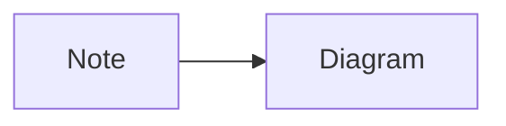

# Your Blog Post Title

**Published:** Month Day, Year

## Introduction

Start with why this topic matters. What problem are you solving or what question are you answering?

## Section 1: Main Point

Write your content here. Use:

- **Bold** for emphasis
- *Italics* for terminology
- `Code` for technical terms
- Links to [relevant resources](https://example.com)

### Subsection

Break down complex topics into digestible sections.

## Section 2: Technical Details

```python
# Include code examples when relevant
def example_function():
    return "Keep examples concise and focused"
```

## Section 3: Real-World Application

Connect technical concepts to practical use cases:

- Energy infrastructure applications
- Public benefit scenarios
- Critical systems considerations

## Key Takeaways

Summarize the main points in a bulleted list:

- First key point
- Second key point
- Third key point

## Diagram



## Further Reading

- Link to related work
- Reference materials
- Other relevant resources

---

*Questions or comments? [Get in touch](/contact/)*
