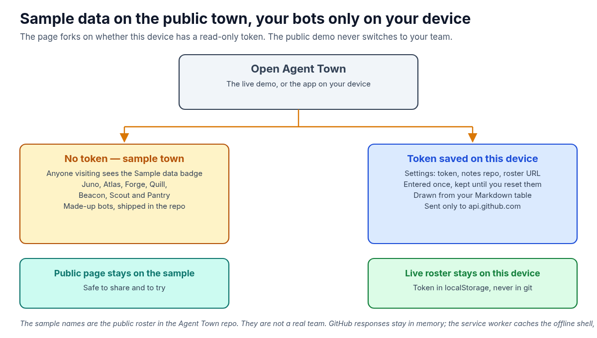
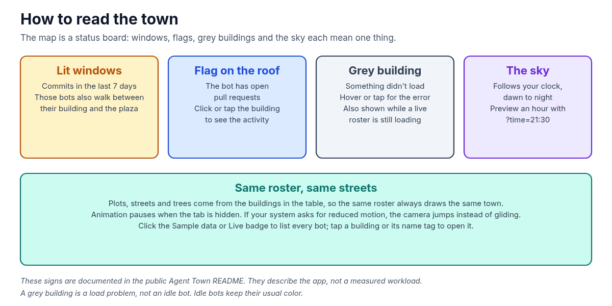
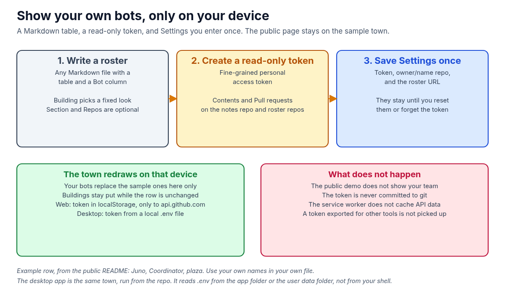

**A team of AI assistants can do a lot of work, and still be hard to see. Their commits sit in one place, their open pull requests in another, and their notes in a third. You only find out someone is stuck when you go looking.**

I've been building a small open-source app called [Agent Town](https://likarajo.github.io/agent-town/). It draws each bot as a building in a 3D town. You can fly over it like a map, or walk its streets and open a building. The public page always shows a labelled **sample** town. Your own bots load only on your devices, after you save a fine-grained, read-only GitHub token.

This is a command center, not a chat app. It doesn't run the bots. It shows you the team.



## 1. What you see on the public town

Open the [live demo](https://likarajo.github.io/agent-town/) and you land in an aerial view, with a **Sample data** badge in the corner. The buildings belong to a made-up roster that ships in the repo. Those bots are not a real team:

| Bot | Job | Building |
|-----|-----|----------|
| Juno | Coordinator | plaza |
| Atlas | Operations | townhall |
| Forge | Builder | workshop |
| Quill | Writer | printshop |
| Beacon | Researcher | lab |
| Scout | Deal Finder | realty |
| Pantry | Meal Planner | depot |

Juno's plaza, Forge's workshop, Beacon's lab: each name gets a fixed look, color and plot. Reordering the table doesn't move a building. If two rows pick the same building, the earlier row keeps the plot. Anything that isn't in the catalog — plaza, townhall, workshop, printshop, lab, realty, depot, bank, consulate or gym — gets a plain building labelled with that word.

The sample is there on purpose. Visitors can learn the map without seeing anyone's real assistants.

## 2. How to read the town

The map is a status board, once you know the signs.

- **Warm, lit windows** mean the bot has commits in the last 7 days. Those bots also walk between their building and the plaza.
- **A flag on the roof** means the bot has open pull requests.
- **A grey building** means something didn't load. Hover over it, or tap it, to see the error. Grey placeholders also stand in while a live roster is loading, and if it can't load at all.
- **The sky** follows your device's clock, from dawn to night. Add `?time=21:30` to the address if you want to preview another hour.

Streets and trees are laid out from the buildings' plots, so the same roster always draws the same town. Animation pauses when the tab is hidden. If your system asks for reduced motion, everything holds still and the camera jumps instead of gliding.

Click the badge at the top right to see every bot in the town with its building, section, repos and activity. Tap a building, or its name tag, to open it.



## 3. Fly over it, or walk the streets

The town opens in the air, like a map app.

| Do this | Mouse and keyboard | Touch |
|---|---|---|
| Pan | Drag, or the arrow keys | Drag with one finger |
| Zoom | Scroll, `+` / `-`, or the zoom buttons | Pinch |
| Turn and tilt | Right-drag or Ctrl-drag | Twist or drag with two fingers |
| Open a building | Click it or its name tag | Tap it |

The compass turns with the view; click it to face north. **2D / 3D** switches between looking straight down and the tilted view. Click the map first so the keys have focus.

**Walk** drops you to street level where the map was looking. Click the town to capture the mouse, then look around; `W` `A` `S` `D` or the arrow keys move you, `Space` jumps, and hold `Shift` to run. `E` or a click opens the building under the crosshair. `Esc` frees the mouse; `Esc` again, or **Aerial**, takes you back up. On a phone, a joystick and a **Jump** button do the same job. Walls, trees and the island's edge stop you; you can't climb onto roofs.

On a device that can't draw 3D (no WebGL), the town falls back to the flat 2D map automatically. Add `?view=2d` to the address to see that view anyway. The 3D code, built with three.js, is a separate download, fetched only when 3D is used.

## 4. Show your own bots, only on your device

The public page never switches to your team. To see your own bots, you add a roster file to a GitHub repo — usually a notes wiki — and you save settings on that device.

Any Markdown file works if it has a table with a `Bot` column. The rest of the page is ignored. A row looks like this, using the same made-up coordinator as the sample:

```markdown
| Bot | Job | Building | Section | Repos |
|-----|-----|----------|---------|-------|
| Juno | Coordinator | plaza | inbox | your-user/notes-app |
```

- **Bot** (required): the name on the building.
- **Job:** shown under the name.
- **Building:** one of the catalog names above, or any other word for a plain labelled building.
- **Section:** the bot's folder in that notes repo. The building can show that folder's `index.md` and its recent commits.
- **Repos:** comma-separated `owner/name` repos whose open pull requests and recent commits show on the building.

Then create a [fine-grained token](https://github.com/settings/personal-access-tokens/new) with read-only **Contents** and **Pull requests** access to the notes repo and every repo in the roster. In **Settings**, fill in the token, the repo as `owner/name`, and the roster URL (the file's GitHub link, or its path inside that repo). The town redraws with your bots.

Settings are a one-time step. They stay saved on the device, across restarts, until you choose **Reset all settings** or **Forget token**. The token never goes in git. On the web it lives in that device's `localStorage` and is sent only to `https://api.github.com`. GitHub responses are kept in memory, not cached by the service worker; the service worker only caches the offline shell.

The same town also runs as a Windows and macOS desktop app from the repo. There it reads the token from a `.env` file on your machine instead of Settings, and it doesn't pick up a `GITHUB_TOKEN` you may have exported for other tools. You can also add the web app to an iPhone home screen from Safari (**Share → Add to Home Screen**).



## 5. A short checklist

When you open Agent Town, or point it at your own team:

1. Believe the badge. **Sample data** means you are looking at the made-up roster, not anyone's real bots.
2. Read the buildings: lit windows for recent commits, a roof flag for open pull requests, grey for a load problem.
3. Fly first, then walk. Use `?view=2d` if you want the flat map, or if 3D isn't available.
4. Keep your roster in a Markdown table with a `Bot` column, and give each bot a stable Building value so it doesn't move.
5. Use a fine-grained, read-only token, save Settings once, and keep that token off git.

The code and the sample roster are in the [agent-town repo](https://github.com/likarajo/agent-town). The town you can try right now is the [public demo](https://likarajo.github.io/agent-town/).

If you already have a team of assistants, what would you want to see on the map first: who's been busy, or whose work is waiting? I'd love to hear in the comments.

#AI #AIAgents #OpenSource #SoftwareEngineering #PWA
