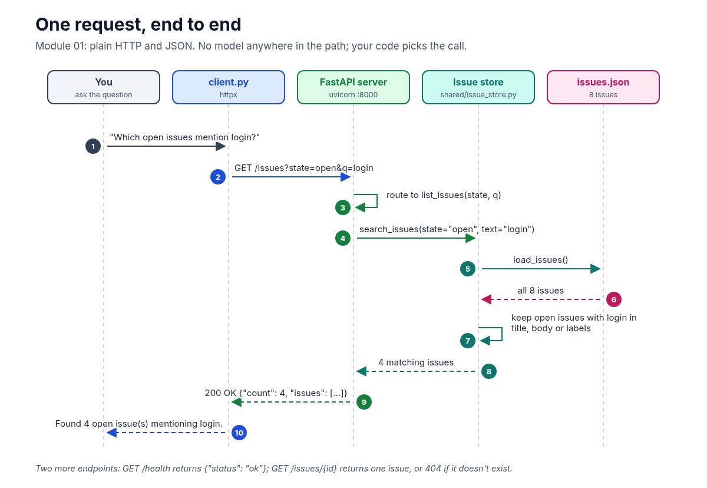
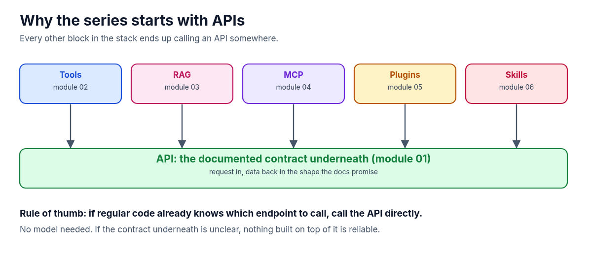
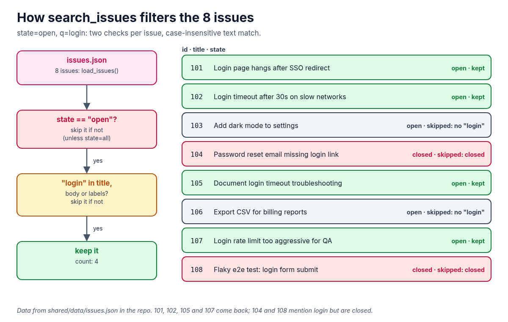

**Before an agent can use tools, search documents or talk over MCP, something underneath has to answer requests. That something is an API. This guide sets up Module 01 of the AI Agent Stack repo, runs it, and follows one request all the way through.**

In the [AI Agent Stack overview](/writing/ai-agent-stack-mcp-rag-apis-tools-plugins-skills/), I compared the six building blocks people mix up: APIs, tools, RAG, MCP, plugins and skills. The companion repo turns each one into a small module you can clone and run. This post covers the first one: [github.com/likarajo/ai-agent-stack/tree/main/01-apis](https://github.com/likarajo/ai-agent-stack/tree/main/01-apis).

It's the simplest module on purpose. There's no AI in it at all. You run a tiny issue tracker API, ask it one question with regular code, and check the answer with tests. Every later module builds on this same API.



## Watch the video

<!-- VIDEO: add embed for YOUTUBE_VIDEO_ID when uploaded -->

## 1. What it is

An **API** is a documented contract that lets one program talk to another. You call an endpoint, and you get data back in the shape the docs promise. In this module that means HTTP requests and JSON responses.

The module is a local **Northwind Issue Tracker**: a FastAPI app over a JSON file of 8 issues. It has three endpoints:

| Endpoint | What it returns |
|----------|-----------------|
| `GET /health` | `{"status": "ok"}` |
| `GET /issues?state=open&q=login` | `{"count": N, "issues": [...]}`, filtered by state (`open`, `closed` or `all`) and a case-insensitive text search |
| `GET /issues/{id}` | One issue, or `404` with `"Issue {id} not found"` |

The important part is who decides. **You** pick the endpoint and the parameters, in code. No model is choosing anything.

## 2. Why it matters

Every other block in the stack ends up calling an API somewhere. In Module 02, a model *proposes* a tool call like `search_issues(state="open", text="login")`, but your code still runs it, against this same data. RAG, MCP, plugins and skills sit further up, and they all lean on a contract like this one.



That gives a simple rule of thumb: **if regular code already knows which endpoint to call, call the API directly.** You don't need a model for that. And if the contract underneath is unclear, nothing you build on top of it will be reliable.

## 3. The running example

The whole series uses one question: **"Which open issues mention login?"**

Here it becomes a single request: `GET /issues?state=open&q=login`. The issue store loads the 8 issues, skips any that aren't open, and keeps the ones with "login" in the title, body or labels.



Four issues come back: 101, 102, 105 and 107. Issues 104 and 108 also mention login, but they're closed, so they're filtered out.

## 4. Set it up

You need **Python 3.11 or newer** and git. There's an optional Docker Compose file too, but you don't need it.

Clone the repo and create a virtual environment from the repo root:

```bash
git clone https://github.com/likarajo/ai-agent-stack.git
cd ai-agent-stack
python3 -m venv .venv
source .venv/bin/activate
pip install -r 01-apis/requirements.txt
```

That installs four packages: `fastapi`, `uvicorn`, `httpx` and `pytest`. There are no API keys to set.

Run everything from the **repo root**, so the `shared/` package (the issue store and its data) can be imported.

## 5. Run it

Start the API in one terminal:

```bash
PYTHONPATH=.:01-apis python -m uvicorn issue_api.server:app --host 127.0.0.1 --port 8000
```

You'll see `Uvicorn running on http://127.0.0.1:8000`. Check it's alive from a second terminal (activate the same `.venv` there):

```bash
curl -s localhost:8000/health; echo
# {"status":"ok"}
```

Now ask the running-example question with the client:

```bash
PYTHONPATH=.:01-apis python 01-apis/issue_api/client.py
```

The client prints the JSON response (the four issues) and ends with:

```text
Found 4 open issue(s) mentioning login.
```

In the server terminal, the request shows up as `GET /issues?state=open&q=login HTTP/1.1" 200 OK`.

Finally, ask for an issue that doesn't exist:

```bash
curl -s localhost:8000/issues/9999; echo
# {"detail":"Issue 9999 not found"}
```

That's a `404 Not Found`. A good contract tells you clearly when there's nothing there.

## 6. How it works inside

There are three small files to read, in this order:

1. **`01-apis/issue_api/client.py`** sends the fixed request with `httpx`. It doesn't guess anything:

   ```python
   resp = client.get("/issues", params={"state": "open", "q": "login"})
   resp.raise_for_status()
   return resp.json()
   ```

2. **`01-apis/issue_api/server.py`** is the FastAPI app. The `/issues` route passes the query parameters to the store and wraps the result:

   ```python
   @app.get("/issues")
   def list_issues(
       state: str = Query("open", description="open | closed | all"),
       q: str | None = Query(None, description="Case-insensitive text search"),
   ) -> dict:
       issues = search_issues(state=state, text=q)
       return {"count": len(issues), "issues": issues}
   ```

3. **`shared/issue_store.py`** loads `shared/data/issues.json` and does the filtering. An issue is skipped if its state doesn't match (unless you ask for `all`), or if the search text isn't in its title, body or labels.

The same store is shared with the later modules, so the answer to the login question stays the same as the stack grows.

## 7. Test it

Stop the server with Ctrl+C if you like. The tests don't need it, because they call the app in-process with FastAPI's `TestClient`:

```bash
PYTHONPATH=. pytest 01-apis/tests -q -rA
```

```text
....                                                                     [100%]
=========================== short test summary info ============================
PASSED 01-apis/tests/test_apis_smoke.py::test_health
PASSED 01-apis/tests/test_apis_smoke.py::test_search_open_login_issues
PASSED 01-apis/tests/test_apis_smoke.py::test_get_issue
PASSED 01-apis/tests/test_apis_smoke.py::test_missing_issue
```

(`-q -rA` is the quiet progress plus short pass summary the module README uses. Pass lines may vary slightly by pytest version.)

The four smoke tests check the health endpoint, the open login search (every result is open and the titles mention login), fetching issue 101, and the 404 for issue 9999. No model and no keys are involved.

## What's next

Module 02 adds **tools**: a model looks at the same question and proposes the call, `search_issues(state="open", text="login")`, while your code still decides whether to run it. The API from this module stays exactly where it is, underneath.

Code: [github.com/likarajo/ai-agent-stack/tree/main/01-apis](https://github.com/likarajo/ai-agent-stack/tree/main/01-apis)
