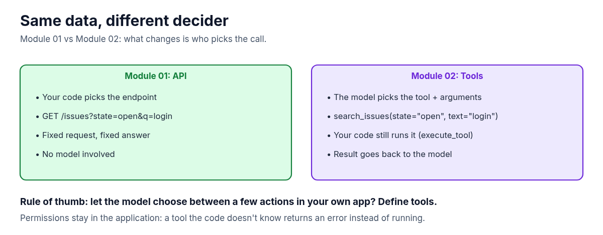
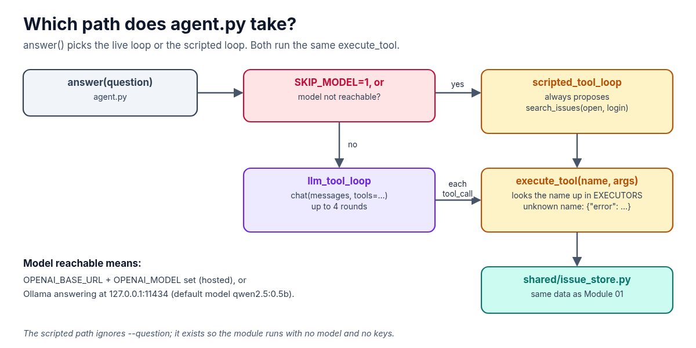

**A model can't search your issue tracker. It can only ask. Tools, also called function calling, are how it asks: the model proposes a call, your code decides whether to run it. This guide sets up Module 02 of the AI Agent Stack repo, runs it, and follows one tool call all the way through.**

In the [AI Agent Stack overview](/writing/ai-agent-stack-mcp-rag-apis-tools-plugins-skills/), I compared the six building blocks people mix up: APIs, tools, RAG, MCP, plugins and skills. [Module 01](/writing/ai-agent-stack-01-apis-setup/) set up the layer underneath: a small issue tracker API that answers one question with plain HTTP. This post covers the next module: [github.com/likarajo/ai-agent-stack/tree/main/02-tools](https://github.com/likarajo/ai-agent-stack/tree/main/02-tools).

Same data, same question. The difference is who picks the call. In Module 01, your code did. Here, a model does, and your code still runs it.


## 1. What it is

A **tool** is a function you describe to a model: a name, a plain-English description, and a JSON schema for the inputs. When the model decides a function would help, it replies with a structured **tool call** instead of text.

The part that's easy to miss: **the model doesn't run anything.** Your application runs the function, then sends the result back so the model can finish its answer.

This module defines two tools over the same Northwind issue store from Module 01:

| Tool | Inputs | What your code returns |
|------|--------|------------------------|
| `search_issues` | `state` (`open`, `closed` or `all`) and `text` (required) | `{"count": N, "issues": [...]}` |
| `get_issue` | `issue_id` (integer, required) | One issue, or `{"error": "Issue {id} not found"}` |

The model only ever sees these descriptions and the JSON results your code hands back.

## 2. Why it matters

With a plain API, your code already knows which endpoint to call. Tools are for the case where it doesn't: the model reads the question and picks the action and the arguments.



Because your code does the running, **permissions stay in the application.** The model can propose anything, but only functions you registered can run. Ask for a tool that isn't there and you get an error back, not an action.

That gives the rule of thumb for this module: **want the model to choose between a few actions in your own app? Define tools.**

## 3. The running example

The question is the same as in Module 01: **"Which open issues mention login?"**

This time it turns into a tool call: `search_issues(state="open", text="login")`. Your code runs it against the shared issue store, which returns the same four open issues: 101, 102, 105 and 107.

The module can run two ways, and both end up in the same `execute_tool` function:



- **No model (the default for this guide).** A scripted stand-in proposes the call a capable model would make. No downloads, no keys.
- **With a model.** If [Ollama](https://ollama.com) is running locally (default model `qwen2.5:0.5b`), or you point it at a hosted OpenAI-compatible endpoint, the model makes the choice for real.

## 4. Set it up

You need **Python 3.11 or newer** and git. A model is optional.

Clone the repo and create a virtual environment from the repo root (if you followed Module 01, you can reuse that clone):

```bash
git clone https://github.com/likarajo/ai-agent-stack.git
cd ai-agent-stack
python3 -m venv .venv
source .venv/bin/activate
pip install -r 02-tools/requirements.txt
```

That installs two packages: `httpx` and `pytest`. There are no API keys to set for the default path.

Run everything from the **repo root**, so the `shared/` package (the issue store, its data and the small model client) can be imported.

## 5. Run it

Run the tool loop without a model:

```bash
SKIP_MODEL=1 PYTHONPATH=. python 02-tools/tools_demo/agent.py
```

```text
[scripted tools mode — no LLM]
Tool call: search_issues({"state": "open", "text": "login"})
Found 4 open issue(s) mentioning login:
- #101 Login page hangs after SSO redirect
- #102 Login timeout after 30s on slow networks
- #105 Document login timeout troubleshooting
- #107 Login rate limit too aggressive for QA
```

The second line is the tool call. That's the structured request a model would send: a tool name and JSON arguments. The rest is what your code got back from running it.

One thing to know: the scripted path always proposes this same call, whatever you pass as `--question`. It's there so the module runs anywhere. To have a model choose for real, start Ollama and pull the default model, then run without `SKIP_MODEL`:

```bash
ollama pull qwen2.5:0.5b
PYTHONPATH=. python 02-tools/tools_demo/agent.py --question "Which open issues mention login?"
```

Or use a hosted OpenAI-compatible endpoint by setting `OPENAI_BASE_URL`, `OPENAI_API_KEY` and `OPENAI_MODEL` first. A model may choose differently from the scripted stand-in, so your answer can differ. That's the point of the next step: whatever the model asks for, your code is the one that runs it.

## 6. How it works inside

There are two small files to read, in this order:

1. **`02-tools/tools_demo/tools.py`** holds the tool schemas and the code that runs them. Each schema is what the model sees:

   ```python
   {
       "type": "function",
       "function": {
           "name": "search_issues",
           "description": "Search the issue tracker by state and free-text query.",
           "parameters": {
               "type": "object",
               "properties": {
                   "state": {"type": "string", "enum": ["open", "closed", "all"], ...},
                   "text": {"type": "string", ...},
               },
               "required": ["text"],
           },
       },
   }
   ```

   And `execute_tool` is the only place anything runs. It accepts arguments as a dict or a JSON string, and it refuses names it doesn't know:

   ```python
   def execute_tool(name: str, arguments: dict[str, Any] | str) -> dict[str, Any]:
       if isinstance(arguments, str):
           arguments = json.loads(arguments) if arguments else {}
       if name not in EXECUTORS:
           return {"error": f"Unknown tool: {name}"}
       return EXECUTORS[name](**arguments)
   ```

   Calling it directly shows both guard rails: `execute_tool("get_issue", '{"issue_id": 9999}')` returns `{"error": "Issue 9999 not found"}`, and `execute_tool("delete_issue", {"issue_id": 101})` returns `{"error": "Unknown tool: delete_issue"}`. Nothing gets deleted, because there's no such tool.

2. **`02-tools/tools_demo/agent.py`** runs the loop. With a model, it sends the conversation plus the tool definitions, runs every tool call the model asks for, and appends the result as a `tool` message. It stops when the model answers in text, or after 4 rounds:

   ```python
   for _ in range(max_rounds):
       reply = chat(messages, tools=TOOL_DEFINITIONS, settings=SETTINGS)
       tool_calls = reply.get("tool_calls") or []
       if not tool_calls:
           return reply.get("content") or "(empty model response)"
       messages.append(reply)
       for tc in tool_calls:
           fn = tc.get("function") or {}
           name = fn.get("name")
           args = fn.get("arguments") or {}
           result = execute_tool(name, args)
           messages.append({"role": "tool", "tool_name": name, "content": json.dumps(result)})
   ```

Underneath, `execute_tool` calls the same `shared/issue_store.py` that served the API in Module 01, so the four results don't change.

## 7. Test it

The tests don't need a model:

```bash
PYTHONPATH=. pytest 02-tools/tests -q -rA
```

```text
.....                                                                    [100%]
=========================== short test summary info ============================
PASSED 02-tools/tests/test_tools_smoke.py::test_tool_schemas_present
PASSED 02-tools/tests/test_tools_smoke.py::test_execute_search_issues
PASSED 02-tools/tests/test_tools_smoke.py::test_execute_get_issue
PASSED 02-tools/tests/test_tools_smoke.py::test_unknown_tool
PASSED 02-tools/tests/test_tools_smoke.py::test_scripted_loop
```

(`-q -rA` is the quiet progress plus short pass summary the module README uses. Pass lines may vary slightly by pytest version.)

The five smoke tests check that both tool schemas are defined, that `search_issues` returns only open login issues, that `get_issue` returns issue 101, that an unknown tool returns an error, and that the scripted loop prints the tool call.

## What's next

Tools let the model act on data. Module 03 adds **RAG**: instead of calling a function, the agent retrieves the right passages from your own docs (a runbook and design notes about login timeouts) so its answer is grounded in what your team already wrote.

Code: [github.com/likarajo/ai-agent-stack/tree/main/02-tools](https://github.com/likarajo/ai-agent-stack/tree/main/02-tools)
