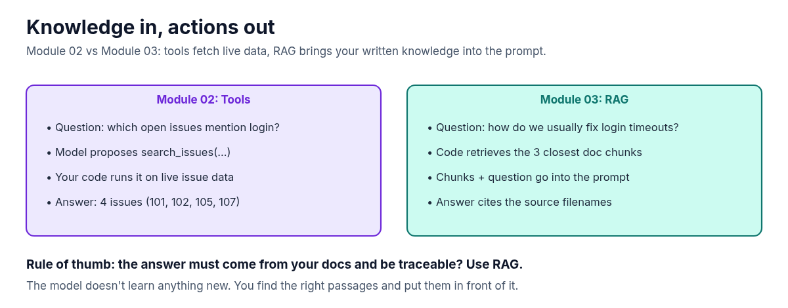

**A model doesn't know how your team fixes login timeouts. Your runbook does. RAG (retrieval-augmented generation) finds the right passages in your own docs and puts them in front of the model at question time. This guide sets up Module 03 of the AI Agent Stack repo, runs it, and looks closely at what it actually retrieved.**

In the [AI Agent Stack overview](/writing/ai-agent-stack-mcp-rag-apis-tools-plugins-skills/), I compared the six building blocks people mix up: APIs, tools, RAG, MCP, plugins and skills. [Module 01](/writing/ai-agent-stack-01-apis-setup/) set up the issue tracker API, and [Module 02](/writing/ai-agent-stack-02-tools-setup/) let a model propose tool calls against it. This post covers the next module: [github.com/likarajo/ai-agent-stack/tree/main/03-rag](https://github.com/likarajo/ai-agent-stack/tree/main/03-rag).

Tools fetch live data. RAG brings in written knowledge. This module has no tools at all: just three Markdown docs, a tiny local index, and one question.


## Watch the video

<!-- TODO: replace YOUTUBE_VIDEO_ID (2 places) once the video is public, or remove this section -->
<div class="video-embed" style="position:relative;width:100%;aspect-ratio:16/9;margin:1.25rem 0 0.5rem;overflow:hidden">
  <iframe
    src="https://www.youtube-nocookie.com/embed/YOUTUBE_VIDEO_ID"
    title="AI Agent Stack, Module 03: RAG — Likarajo Tech"
    loading="lazy"
    allow="accelerometer; autoplay; clipboard-write; encrypted-media; gyroscope; picture-in-picture; web-share"
    allowfullscreen
    referrerpolicy="strict-origin-when-cross-origin"
    style="position:absolute;inset:0;width:100%;height:100%;border:0"
  ></iframe>
</div>

<p><a href="https://youtu.be/YOUTUBE_VIDEO_ID">https://youtu.be/YOUTUBE_VIDEO_ID</a></p>

## 1. What it is

**RAG** gives a model relevant information from *your* data at question time. The model doesn't learn anything new. Your code finds the right passages and puts them in the prompt, and the answer cites where they came from.

It happens in two phases:

| Phase | What happens in this module |
|-------|-----------------------------|
| Index | Split 3 Markdown docs into 15 chunks and turn each chunk into a vector of 256 numbers |
| Ask | Turn the question into a vector the same way, score every chunk by cosine similarity, keep the top 3 |

The docs live in `shared/data/docs/`: a login timeout runbook, auth design notes, and issue triage conventions for the same fictional Northwind portal as the issue tracker.

## 2. Why it matters

In Module 02, a tool fetched live issue data. Some questions aren't about live data, though. "How do we usually fix login timeouts?" is answered by a runbook somebody wrote, not by a database query.



That gives the rule of thumb for this module: **the answer must come from your docs and be traceable? Use RAG.** The sources line is the traceable part. If the answer is wrong, you can open the file and see why.

## 3. The running example

The question for this module is: **"How do we usually fix login timeouts?"**

The runbook has a "Standard fix order" section with six steps, starting with reproducing in an incognito window and checking `/health/auth` latency. Ideally, that's the chunk the retriever finds. You'll see in a moment that it doesn't, and why.

## 4. Set it up

You need **Python 3.11 or newer** and git. A model is optional.

Clone the repo and create a virtual environment from the repo root (you can reuse the clone from the earlier modules):

```bash
git clone https://github.com/likarajo/ai-agent-stack.git
cd ai-agent-stack
python3 -m venv .venv
source .venv/bin/activate
pip install -r 03-rag/requirements.txt
```

That installs three packages: `numpy`, `httpx` and `pytest`. There are no API keys to set, and nothing to download for the embeddings.

Run everything from the **repo root**, so the `shared/` package (the docs, the embedder and the small model client) can be imported.

## 5. Run it

Run the question without a model:

```bash
PYTHONHASHSEED=0 SKIP_MODEL=1 PYTHONPATH=. python 03-rag/rag_demo/ask.py
```

(`PYTHONHASHSEED=0` makes the scores repeatable. More on that in the next section.)

```text
[extractive RAG — no LLM]
Question: How do we usually fix login timeouts?

Top passages:
[auth-design-notes.md | score=0.658]
## Agent-friendly tip
When someone asks "how do we usually fix login timeouts?", start from the login-timeout runbook, then search open issues mentioning login.

---

[login-timeout-runbook.md | score=0.218]
# Login timeout runbook

---

[auth-design-notes.md | score=0.124]
## Timeouts
The browser client historically used a 30s hard timeout around step 4.
On constrained mobile networks the token exchange can exceed 30s, which looks like a hung login.

Sources: auth-design-notes.md, login-timeout-runbook.md
```

Without a model, the module prints the retrieved passages instead of a generated answer. That's useful, because it shows exactly what a model would have been given.

And here's the honest part. Look at what came back:


- The top hit is a note that repeats the question almost word for word and says "start from the login-timeout runbook." It points at the answer but isn't the answer.
- The second hit is the runbook's title line on its own.
- The "Standard fix order" chunk, with the six actual steps, ranks **5th**, so it never reaches the answer.

So the sources are right, but the fix steps themselves aren't in the context. A model given only these three passages has no fix steps to quote. The system prompt tells it to say it doesn't know when something's missing.

To use a model, run without `SKIP_MODEL` while Ollama is running (default model `qwen2.5:0.5b`), or set `OPENAI_BASE_URL`, `OPENAI_API_KEY` and `OPENAI_MODEL` for a hosted OpenAI-compatible endpoint. If Ollama also has `nomic-embed-text` pulled, the module uses it for embeddings instead of the local hashing embedder, so the ranking will be different.

## 6. How it works inside

There are three small files to read, in this order:

1. **`shared/embeddings.py`** does the chunking and the embedding. `chunk_markdown` splits on blank lines (500 characters max per chunk), which is why a heading can end up as a chunk on its own. `hash_embed` counts words into 256 buckets:

   ```python
   def hash_embed(text: str, dim: int = 256) -> np.ndarray:
       """Deterministic local embedding that needs no model download."""
       vec = np.zeros(dim, dtype=np.float32)
       for token in tokenize(text):
           idx = hash(token) % dim
           vec[idx] += 1.0
       norm = float(np.linalg.norm(vec))
       if norm:
           vec /= norm
       return vec
   ```

   This is a bag of words, not meaning. "timeouts" and "timeout" are different words to it, which is a big part of why the fix-order chunk (it says "timeout") ranks low for a question that says "timeouts".

   It's also why `PYTHONHASHSEED=0` is in the run command. Python's built-in `hash()` is salted per process for strings, so without a fixed seed, words land in different buckets on every run. In my runs the top hit stayed the same, but the scores and the 2nd and 3rd hits changed from run to run.

2. **`03-rag/rag_demo/index.py`** builds the index. It reads every `*.md` file in `shared/data/docs/`, chunks it, and stacks the vectors into a 15 × 256 matrix. The index is rebuilt in memory on every run. Nothing is written to disk.

3. **`03-rag/rag_demo/ask.py`** retrieves the top 3 chunks, formats them with their source and score, and either prints them (no model) or sends them to the model with a strict instruction:

   ```python
   {
       "role": "system",
       "content": (
           "Answer only from the provided context. "
           "Cite source filenames. If missing, say you don't know."
       ),
   },
   ```

If you want to see the full ranking yourself, this prints the score of every chunk:

```bash
PYTHONHASHSEED=0 SKIP_MODEL=1 PYTHONPATH=.:03-rag python -c "
from rag_demo.index import build_index
from shared.embeddings import embed_texts, top_k
ix = build_index()
q = embed_texts(['How do we usually fix login timeouts?'])[0]
for rank, (i, score) in enumerate(top_k(q, ix.matrix, k=15), 1):
    print(rank, round(score, 3), ix.chunks[i].source, ix.chunks[i].text.splitlines()[0])
"
```

## 7. Test it

The tests don't need a model:

```bash
PYTHONPATH=. pytest 03-rag/tests -p no:warnings
```

```text
...                                          [100%]
3 passed in 0.15s
```

(`-p no:warnings` only hides a dependency warning so the result is easy to read. The tests pass either way, and the timing will differ on your machine.)

The three smoke tests check that the index has chunks (one vector per chunk), that retrieval for the login timeout question returns login or timeout text from an auth or runbook source, and that the no-model answer includes a sources line. They check that retrieval lands in the right files, not that it finds the fix steps, which is exactly the gap the run above shows.

## What's next

So far, the tools from Module 02 only work inside one app. Module 04 wraps the same issue tools in an **MCP server**, so any MCP-capable host can discover and call them over a standard protocol, without copying the tool code.

Code: [github.com/likarajo/ai-agent-stack/tree/main/03-rag](https://github.com/likarajo/ai-agent-stack/tree/main/03-rag)
