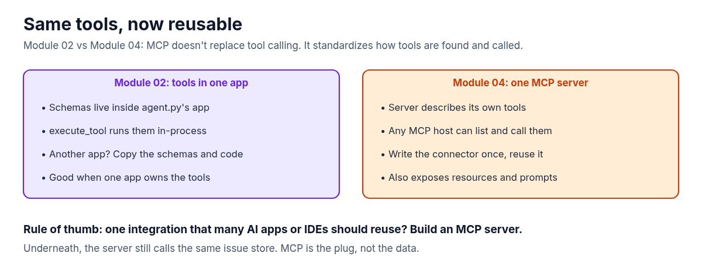

**The tools from Module 02 only work inside the app that defines them. MCP (Model Context Protocol) moves them into a small server that any MCP-capable app can discover and call. This guide sets up Module 04 of the AI Agent Stack repo, runs it, and follows one MCP session from start to finish.**

In the [AI Agent Stack overview](/writing/ai-agent-stack-mcp-rag-apis-tools-plugins-skills/), I compared the six building blocks people mix up: APIs, tools, RAG, MCP, plugins and skills. [Module 01](/writing/ai-agent-stack-01-apis-setup/) set up the issue tracker API, [Module 02](/writing/ai-agent-stack-02-tools-setup/) turned it into tools a model can call, and [Module 03](/writing/ai-agent-stack-03-rag-setup/) grounded answers in the team's docs. This post covers the next module: [github.com/likarajo/ai-agent-stack/tree/main/04-mcp](https://github.com/likarajo/ai-agent-stack/tree/main/04-mcp).

Same issue store, same question. The new part is the plug: a standard way to connect the tools, so you write them once and reuse them across apps.


## Watch the video

<!-- VIDEO: add embed for YOUTUBE_VIDEO_ID when uploaded -->

## 1. What it is

**MCP** is an open protocol that standardizes how AI apps connect to outside tools and data. A common comparison is USB-C: build the connector once, and any compatible host can use it.

There are three roles:

| Role | In this module |
|------|----------------|
| Host | The AI app you work in (a chat app, an IDE, an agent). Here there isn't one; the demo client stands in. |
| Client | Lives inside the host and talks to one server. Here it's `04-mcp/client/demo.py`. |
| Server | Wraps a real system and describes what it offers. Here it's `04-mcp/server/issue_tracker.py`. |

The server offers three kinds of things: **tools** (actions the model can call), **resources** (data the host can read) and **prompts** (reusable templates).


## 2. Why it matters

MCP doesn't replace tool calling. It standardizes how tools are **found and called**. In Module 02, the tool schemas lived inside one app. If a second app wanted the same tools, you'd copy the schemas and the code. With MCP, the server describes its own tools, and any host that speaks MCP can list them and call them.



That gives the rule of thumb for this module: **one integration that many AI apps or IDEs should reuse? Build an MCP server.** If only one app will ever use the tools, plain tools from Module 02 are simpler.

## 3. The running example

The question is the same as in Modules 01 and 02: **"Which open issues mention login?"**

This time it's an MCP tool call: `call_tool("search_issues_tool", {"state": "open", "text": "login"})`. The server runs it against the shared issue store and returns the same four open issues: 101, 102, 105 and 107.

There's no model in this module. The client is plain code that always makes this one call, so you can see the protocol on its own. In a real host, the client would hand the tool list to a model and let it choose, like in Module 02.

## 4. Set it up

You need **Python 3.11 or newer** and git. There's no model and there are no API keys.

Clone the repo and create a virtual environment from the repo root (you can reuse the clone from the earlier modules):

```bash
git clone https://github.com/likarajo/ai-agent-stack.git
cd ai-agent-stack
python3 -m venv .venv
source .venv/bin/activate
pip install -r 04-mcp/requirements.txt
```

That installs the official MCP Python SDK (`mcp`, version 2.0 or newer), `httpx` and `pytest`. I ran it with `mcp` 2.3.0.

Run everything from the **repo root**, so the server can import the `shared/` package.

## 5. Run it

You only need one terminal. The client starts the server itself:

```bash
PYTHONPATH=. python 04-mcp/client/demo.py
```

It prints the tools it discovered, the tool it called, and the raw result (shortened here):

```text
{
  "tools": [
    "search_issues_tool",
    "get_issue_tool"
  ],
  "call": "search_issues_tool",
  "raw": "{\n  \"count\": 4,\n  \"issues\": [\n    {\n      \"id\": 101,\n      \"title\": \"Login page hangs after SSO redirect\", ...
}
```

The `raw` field is the tool result as text, exactly as it came over the protocol. Inside it are the four issues: 101, 102, 105 and 107.

The demo only uses tools. To see the resource and the prompt too, save this as `explore_mcp.py` in the repo root and run `PYTHONPATH=. python explore_mcp.py`:

```python
import asyncio, json, os, sys
from mcp import ClientSession, StdioServerParameters
from mcp.client.stdio import stdio_client

async def main():
    params = StdioServerParameters(
        command=sys.executable, args=["04-mcp/server/issue_tracker.py"],
        env={**os.environ, "PYTHONPATH": "."}, cwd=".")
    async with stdio_client(params) as (read, write):
        async with ClientSession(read, write) as s:
            init = await s.initialize()
            print("server:", init.server_info.name, "protocol:", init.protocol_version)
            print("resources:", [str(r.uri) for r in (await s.list_resources()).resources])
            print("prompts:", [p.name for p in (await s.list_prompts()).prompts])
            prompt = await s.get_prompt("login_issue_prompt")
            print("prompt text:", prompt.messages[0].content.text)
            res = await s.read_resource("issues://open")
            print("open issues in resource:", len(json.loads(res.contents[0].text)))
            missing = await s.call_tool("get_issue_tool", {"issue_id": 9999})
            print("get 9999:", missing.content[0].text)

asyncio.run(main())
```

```text
server: northwind-issue-tracker protocol: 2025-11-25
resources: ['issues://open']
prompts: ['login_issue_prompt']
prompt text: Which open issues mention login? Use search_issues_tool.
open issues in resource: 6
get 9999: {
  "error": "Issue 9999 not found"
}
```

The resource returns all 6 open issues, not just the login ones. And asking for an issue that doesn't exist gives a clear error back, the same contract as in Module 01.

## 6. How it works inside

There are two small files to read, in this order:

1. **`04-mcp/server/issue_tracker.py`** is the server, built with `MCPServer` from the official SDK. Each decorator registers one thing a host can discover:

   ```python
   mcp = MCPServer(
       name="northwind-issue-tracker",
       instructions=(
           "Tools for the Northwind portal issue tracker. "
           "Use search_issues for questions like 'Which open issues mention login?'."
       ),
   )

   @mcp.tool(description="Search issues by state and free-text query.")
   def search_issues_tool(state: str = "open", text: str = "") -> dict:
       issues = search_issues(state=state, text=text)
       return {"count": len(issues), "issues": issues}

   @mcp.resource("issues://open")
   def open_issues_resource() -> str:
       """Resource: current open issues as JSON."""
       return json.dumps(search_issues(state="open", text=None), indent=2)

   @mcp.prompt()
   def login_issue_prompt() -> str:
       """Reusable prompt template for the article's example question."""
       return "Which open issues mention login? Use search_issues_tool."
   ```

   Notice there's no hand-written JSON schema like in Module 02. The SDK builds the tool's input schema from the Python type hints. `mcp.run()` at the bottom serves it over stdio, which is the usual transport for local servers.

2. **`04-mcp/client/demo.py`** starts the server as a child process and runs the session: `initialize`, then `list_tools`, then `call_tool`:

   ```python
   params = StdioServerParameters(command=sys.executable, args=[str(SERVER)], env=env, cwd=str(ROOT))
   async with stdio_client(params) as (read, write):
       async with ClientSession(read, write) as session:
           await session.initialize()
           tools = await session.list_tools()
           result = await session.call_tool("search_issues_tool", {"state": state, "text": text})
   ```

Underneath, the server still calls the same `shared/issue_store.py` as the earlier modules. MCP is the plug, not the data.

## 7. Test it

The tests don't need a model:

```bash
PYTHONPATH=. pytest 04-mcp/tests -q -rA
```

```text
...                                                                      [100%]
=========================== short test summary info ============================
PASSED 04-mcp/tests/test_mcp_smoke.py::test_tools_registered
PASSED 04-mcp/tests/test_mcp_smoke.py::test_search_tool_direct
PASSED 04-mcp/tests/test_mcp_smoke.py::test_stdio_client_roundtrip
```

(`-q -rA` is the quiet progress plus short pass summary the module README uses. Pass lines may vary slightly by pytest version.)

The three smoke tests check that both tools are registered on the server, that calling `search_issues_tool` directly finds at least one open login issue, and a full stdio round trip through the demo client. That last one starts a real server process, which is why this module's tests take about a second.

## What's next

An MCP server is one piece. A real setup also needs skills, commands and settings, and somebody has to install all of it. Module 05 adds **plugins**: one manifest that bundles this MCP server with a skill and two commands, and one install step that wires it all up.

Code: [github.com/likarajo/ai-agent-stack/tree/main/04-mcp](https://github.com/likarajo/ai-agent-stack/tree/main/04-mcp)
