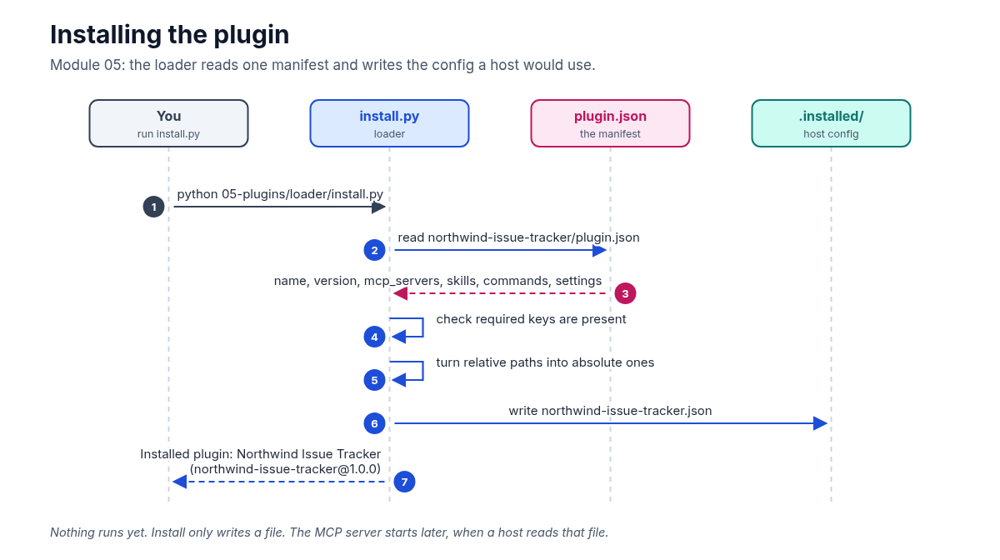
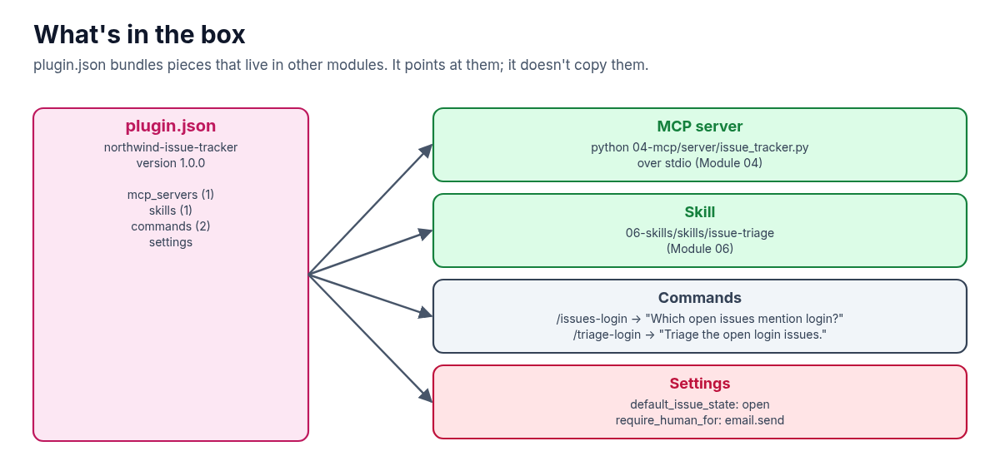

**By Module 04, the issue tracker setup has an MCP server, and a skill and commands are coming. Asking someone to wire all of that up by hand is a lot. A plugin puts it in one box with one install step. This guide sets up Module 05 of the AI Agent Stack repo, runs the install, and shows what a host does with the result.**

In the [AI Agent Stack overview](/writing/ai-agent-stack-mcp-rag-apis-tools-plugins-skills/), I compared the six building blocks people mix up: APIs, tools, RAG, MCP, plugins and skills. [Module 01](/writing/ai-agent-stack-01-apis-setup/) set up the issue tracker API, and [Module 04](/writing/ai-agent-stack-04-mcp-setup/) turned the tools into an MCP server any host can use. This post covers the next module: [github.com/likarajo/ai-agent-stack/tree/main/05-plugins](https://github.com/likarajo/ai-agent-stack/tree/main/05-plugins).

This is the shortest module in the repo, and that's the point. A plugin doesn't add a new way for things to talk. It's packaging.



## Watch the video

<!-- TODO: replace YOUTUBE_VIDEO_ID (2 places) once the video is public, or remove this section -->
<div class="video-embed" style="position:relative;width:100%;aspect-ratio:16/9;margin:1.25rem 0 0.5rem;overflow:hidden">
  <iframe
    src="https://www.youtube-nocookie.com/embed/YOUTUBE_VIDEO_ID"
    title="AI Agent Stack, Module 05: Plugins — Likarajo Tech"
    loading="lazy"
    allow="accelerometer; autoplay; clipboard-write; encrypted-media; gyroscope; picture-in-picture; web-share"
    allowfullscreen
    referrerpolicy="strict-origin-when-cross-origin"
    style="position:absolute;inset:0;width:100%;height:100%;border:0"
  ></iframe>
</div>

<p><a href="https://youtu.be/YOUTUBE_VIDEO_ID">https://youtu.be/YOUTUBE_VIDEO_ID</a></p>

## 1. What it is

A **plugin** is a packaged extension for a specific app. In AI apps and IDEs, it usually bundles several pieces into one install: MCP server configs, skills, slash commands, settings, and sometimes UI.

The plugin in this module is one file, `plugin.json`, with these parts:

| Part | What this plugin ships |
|------|------------------------|
| MCP server | `northwind-issue-tracker`, started with `python 04-mcp/server/issue_tracker.py` over stdio |
| Skill | `06-skills/skills/issue-triage` |
| Commands | `/issues-login` and `/triage-login` |
| Settings | `default_issue_state: open` and `require_human_for: ["email.send"]` |



Notice that the manifest **points at** the MCP server and the skill. It doesn't contain them. The server code still lives in Module 04 and the skill in Module 06.

## 2. Why it matters

Without a plugin, setting up the issue tracker in a new AI app means several separate steps: add the MCP server with the right command and environment, copy the skill folder, define the commands, set the defaults. Each one is easy to get slightly wrong. A plugin turns that into one install.

What a plugin is **not** is a new protocol. Once it's installed, the work still flows through the same pieces as before: the host starts the MCP server, the model calls its tools, and the tools read the same issue store.


That gives the rule of thumb for this module: **want other people to install your setup in one step? Ship a plugin.**

## 3. The running example

The plugin is called **Northwind Issue Tracker**, version 1.0.0. Its `/issues-login` command carries the same question as the earlier modules: **"Which open issues mention login?"** Its `/triage-login` command asks for a triage of those issues, which is what the skill in Module 06 does.

The loader in this module plays the part of the host's installer. It reads the manifest, checks it, and writes a resolved config file that a host would load.

## 4. Set it up

You need **Python 3.11 or newer** and git. There's no model and there are no API keys.

Clone the repo and create a virtual environment from the repo root (you can reuse the clone from the earlier modules):

```bash
git clone https://github.com/likarajo/ai-agent-stack.git
cd ai-agent-stack
python3 -m venv .venv
source .venv/bin/activate
pip install -r 05-plugins/requirements.txt
```

The install step only needs `pytest`. If you want to try the optional check in section 5, also install the Module 04 requirements (`pip install -r 04-mcp/requirements.txt`) for the MCP SDK.

Run everything from the **repo root**. The manifest's paths are relative to it.

## 5. Run it

Install the plugin:

```bash
PYTHONPATH=. python 05-plugins/loader/install.py
```

```text
Installed plugin: Northwind Issue Tracker (northwind-issue-tracker@1.0.0)
MCP servers: northwind-issue-tracker
Skills: issue-triage
Commands: issues-login, triage-login
Key point: packaging only — runtime still uses MCP/tools/skills/APIs.

Wrote host config → /path/to/ai-agent-stack/05-plugins/.installed/northwind-issue-tracker.json
```

Open the file it wrote. It's the manifest with two changes: the server script and the skill folder now have absolute paths, and there's a `source_manifest` field saying where it came from:

```json
"mcp_servers": [
  {
    "name": "northwind-issue-tracker",
    "transport": "stdio",
    "command": "python",
    "args": [
      "/path/to/ai-agent-stack/04-mcp/server/issue_tracker.py"
    ],
    "env": {
      "PYTHONPATH": "."
    }
  }
],
```

The `.installed/` folder is in the repo's `.gitignore`, so the install output won't end up in a commit.

**Optional: use the installed config like a host would.** The module stops at install. To check that the config actually works, I wrote a short script that reads it, starts the MCP server it describes, and runs the `/issues-login` question. Save it as `use_plugin.py` in the repo root (it needs the Module 04 requirements):

```python
import asyncio, json, os
from mcp import ClientSession, StdioServerParameters
from mcp.client.stdio import stdio_client

cfg = json.load(open("05-plugins/.installed/northwind-issue-tracker.json"))
server = cfg["mcp_servers"][0]
command = next(c for c in cfg["commands"] if c["name"] == "issues-login")

async def main():
    params = StdioServerParameters(command=server["command"], args=server["args"],
                                   env={**os.environ, **server["env"]}, cwd=".")
    async with stdio_client(params) as (read, write):
        async with ClientSession(read, write) as s:
            await s.initialize()
            print("/issues-login ->", command["prompt"])
            print("tools:", [t.name for t in (await s.list_tools()).tools])
            result = await s.call_tool("search_issues_tool", {"state": cfg["settings"]["default_issue_state"], "text": "login"})
            data = json.loads(result.content[0].text)
            print("count:", data["count"], "ids:", [i["id"] for i in data["issues"]])

asyncio.run(main())
```

```text
/issues-login -> Which open issues mention login?
tools: ['search_issues_tool', 'get_issue_tool']
count: 4 ids: [101, 102, 105, 107]
```

Same four issues as every module before it. The plugin changed how the pieces get installed, not how they run.

## 6. How it works inside

There are two files to read, in this order:

1. **`05-plugins/plugin/northwind-issue-tracker/plugin.json`** is the manifest, the "delivery box". The parts that matter most are the server entry and the commands:

   ```json
   "mcp_servers": [
     {
       "name": "northwind-issue-tracker",
       "transport": "stdio",
       "command": "python",
       "args": ["04-mcp/server/issue_tracker.py"],
       "env": { "PYTHONPATH": "." }
     }
   ],
   "skills": ["06-skills/skills/issue-triage"],
   "commands": [
     { "name": "issues-login", "description": "Search open issues mentioning login",
       "prompt": "Which open issues mention login?" },
     { "name": "triage-login", "description": "Run the issue-triage skill on open login issues",
       "prompt": "Triage the open login issues." }
   ]
   ```

   A command here is just a name plus a prompt. The idea is that typing `/issues-login` in a host sends that prompt for you.

2. **`05-plugins/loader/install.py`** checks the manifest and writes the host config. The check is a list of required keys:

   ```python
   def load_manifest(path: Path) -> dict[str, Any]:
       data = json.loads(path.read_text(encoding="utf-8"))
       required = ["name", "version", "mcp_servers", "skills", "commands"]
       missing = [k for k in required if k not in data]
       if missing:
           raise ValueError(f"plugin manifest missing keys: {missing}")
       return data
   ```

   Then `install_plugin` turns the relative server and skill paths into absolute ones and writes the result to `05-plugins/.installed/<name>.json`.

Real AI apps each have their own plugin format and installer, but the idea is the same: a manifest that lists the pieces, and an installer that wires them into the host.

## 7. Test it

The tests don't need a model:

```bash
PYTHONPATH=. pytest 05-plugins/tests -p no:warnings
```

```text
..                                           [100%]
2 passed in 0.02s
```

(`-p no:warnings` only hides a dependency warning so the result is easy to read. The tests pass either way, and the timing will differ on your machine.)

The two smoke tests check that the manifest has a name, MCP servers, skills and commands, and that installing it into a temporary folder writes a config with the server's arguments and the "packaging only" note.

## What's next

The plugin ships a skill called `issue-triage`, but so far it's only a folder path. Module 06 opens it up: **skills**, the team playbook an agent loads only when a task needs it, and the reason it doesn't load the whole thing up front.

Code: [github.com/likarajo/ai-agent-stack/tree/main/05-plugins](https://github.com/likarajo/ai-agent-stack/tree/main/05-plugins)
