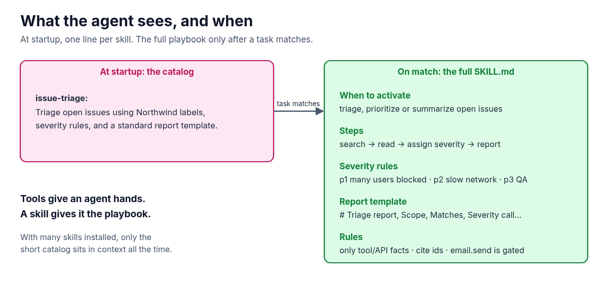

**By Module 05, the agent can search issues, read the team's docs and be installed in one step. What it still doesn't know is how your team does the work: which severity to pick, what a triage report looks like, what it must never do on its own. A skill is that playbook, loaded only when a task needs it. This guide sets up Module 06 of the AI Agent Stack repo, runs it, and shows where its simple matcher gets it wrong.**

In the [AI Agent Stack overview](/writing/ai-agent-stack-mcp-rag-apis-tools-plugins-skills/), I compared the six building blocks people mix up: APIs, tools, RAG, MCP, plugins and skills. [Module 01](/writing/ai-agent-stack-01-apis-setup/) set up the issue tracker API, and [Module 05](/writing/ai-agent-stack-05-plugins-setup/) packaged the setup as a plugin, including a skill called `issue-triage`. This post opens that skill up: [github.com/likarajo/ai-agent-stack/tree/main/06-skills](https://github.com/likarajo/ai-agent-stack/tree/main/06-skills).

Tools give an agent hands. A skill gives it the playbook.


## Watch the video

<!-- VIDEO: add embed for YOUTUBE_VIDEO_ID when uploaded -->

## 1. What it is

A **skill** is a reusable package of instructions. Usually it's a folder with a `SKILL.md` file: a short name and description at the top, then steps, rules, templates and sometimes helper files.

The key idea is **progressive loading**, which happens in two stages:

| Stage | What the agent has in context |
|-------|-------------------------------|
| At startup | Only each skill's name and one-line description: the catalog |
| When a task matches | The full `SKILL.md`: when to use it, the steps, the rules and the report template |



With one skill this doesn't save much. With dozens installed, it means only the short catalog sits in the context window all the time, and each playbook is loaded only when it's needed.

## 2. Why it matters

Tools and MCP let an agent **do** things. Skills make it do them **your way**. Without a skill, you end up repeating the same instructions in every prompt: use these severity levels, keep existing labels, use this report format, cite issue ids, don't send email without asking.

A skill also isn't RAG. RAG from Module 03 looks up **facts** in your docs. A skill teaches a **procedure**. The triage skill even points to the runbook's guidance for severity, but the steps themselves live in the skill.

That gives the rule of thumb for this module: **keep explaining the same procedure to your agent? Write a skill.**

## 3. The running example

The task is **"Triage the open login issues."** The repo ships one skill, `06-skills/skills/issue-triage/SKILL.md`. Its steps are:

1. Search open issues for the symptom text (default: `login`).
2. For each match, read the title, labels, assignee and body.
3. Assign severity: **p1** if production login is blocked for many users, **p2** if it's intermittent or slow-network only, **p3** if it's a staging or QA inconvenience.
4. Prefer existing severity labels when they're already there.
5. Write a triage report using the template, and don't invent issue ids.

It also has rules, including this one: emailing a summary is a gated action (`email.send`), so the agent should propose it, not quietly do it. Module 07 shows that gate working.

## 4. Set it up

You need **Python 3.11 or newer** and git. There's no model and there are no API keys.

Clone the repo and create a virtual environment from the repo root (you can reuse the clone from the earlier modules):

```bash
git clone https://github.com/likarajo/ai-agent-stack.git
cd ai-agent-stack
python3 -m venv .venv
source .venv/bin/activate
pip install -r 06-skills/requirements.txt
```

The only dependency is `pytest`.

Run everything from the **repo root**. This module needs **two** folders on `PYTHONPATH`: `06-skills` for its `agent` package and `.` for `shared/`. That's why the commands below use `PYTHONPATH=06-skills:.`.

## 5. Run it

```bash
PYTHONPATH=06-skills:. python 06-skills/agent/run.py
```

The output has three parts. First, the catalog, which is all the agent sees at startup:

```text
# Skill catalog (startup — names/descriptions only)
- issue-triage: Triage open issues using Northwind labels, severity rules, and a standard report template.
```

Then the selected skill, with the full `SKILL.md` body printed up to the report template. Then the report:

```text
# Triage report
- Scope: open issues matching 'login'
- Matches:
  - #101 Login page hangs after SSO redirect [auth, bug, p1] → severity p1
  - #102 Login timeout after 30s on slow networks [auth, bug, p2] → severity p2
  - #105 Document login timeout troubleshooting [docs, auth] → severity p?
  - #107 Login rate limit too aggressive for QA [auth, infra, p3] → severity p3
- Severity call: p1 (from labels + auth runbook guidance in the skill)
- Next step: Confirm /health/auth latency and link the login-timeout runbook on each open auth bug.
```

The same four issues as every earlier module, now in the team's format. #105 is a docs task with no severity label, so it gets `p?` instead of a made-up level.

Now try a task the skill doesn't cover:

```bash
PYTHONPATH=06-skills:. python 06-skills/agent/run.py --task "What's the weather in Austin?"
```

```text
# Skill catalog (startup — names/descriptions only)
- issue-triage: Triage open issues using Northwind labels, severity rules, and a standard report template.

No skill matched; refusing to invent a playbook.
```

That's the right behavior. But try one more:

```bash
PYTHONPATH=06-skills:. python 06-skills/agent/run.py --task "Summarize the open billing issues."
```

```text
# Triage report
- Scope: open issues matching 'Summarize the open billing issues.'
- Matches:
- Severity call: p3 (from labels + auth runbook guidance in the skill)
- Next step: Confirm /health/auth latency and link the login-timeout runbook on each open auth bug.
```


Two things went wrong here. The skill was selected because the task shares the words "open" and "issues" with the skill's description. Then, since the task doesn't say "login", the demo searched for the whole sentence, found nothing, and still printed a severity call and the login next step. There is an open billing issue, #106 "Export CSV for billing reports". The matcher and the report are a simple demo of the loading pattern. In a real host, a model usually reads the catalog and decides, and it could follow step 1 by searching for "billing".

## 6. How it works inside

There are three files to read, in this order:

1. **`06-skills/skills/issue-triage/SKILL.md`** is the skill itself. The front matter is what goes in the catalog:

   ```markdown
   ---
   name: issue-triage
   description: Triage open issues using Northwind labels, severity rules, and a standard report template.
   ---
   ```

   Everything below it (when to activate, steps, report template, rules) only gets loaded on a match.

2. **`06-skills/agent/loader.py`** has the three steps of progressive loading: `catalog` returns name and description for each skill folder, `select_skill` picks one for the task, and `load_full` returns the whole body. The matcher counts words of four letters or more from the name and description that appear in the task, with a bonus for "triage":

   ```python
   for token in re.findall(r"[a-z0-9-]+", f"{meta.name} {meta.description}".lower()):
       if len(token) < 4:
           continue
       if token in task_l:
           score += 1
   if "triage" in task_l and "triage" in meta.name:
       score += 5
   ```

   That word count is why "open" and "issues" were enough to pick the skill for the billing task.

3. **`06-skills/agent/run.py`** follows the playbook in code. It searches open issues for `login` (or for the whole task, if the task doesn't mention login), keeps each issue's existing `p` label as its severity, takes the highest one as the overall call, and fills in the template. The "Next step" line is fixed text.

## 7. Test it

The tests don't need a model:

```bash
PYTHONPATH=06-skills:. pytest 06-skills/tests -p no:warnings
```

```text
...                                          [100%]
3 passed in 0.01s
```

(`-p no:warnings` only hides a dependency warning so the result is easy to read. The tests pass either way, and the timing will differ on your machine.)

The three smoke tests check that the catalog includes `issue-triage`, that the login triage task selects it and loads a body with the report template and severity rules, and that a full run prints a triage report with #101 or #102 in it.

## What's next

That's all six building blocks, each on its own. Module 07 puts them together: one agent that loads the plugin, picks the skill, retrieves from the docs, calls the MCP server, the tools and the API, and asks a model, with every step recorded in [agent-debugger](https://github.com/likarajo/agent-debugger) and a human approval gate before any email goes out.

Code: [github.com/likarajo/ai-agent-stack/tree/main/06-skills](https://github.com/likarajo/ai-agent-stack/tree/main/06-skills)
