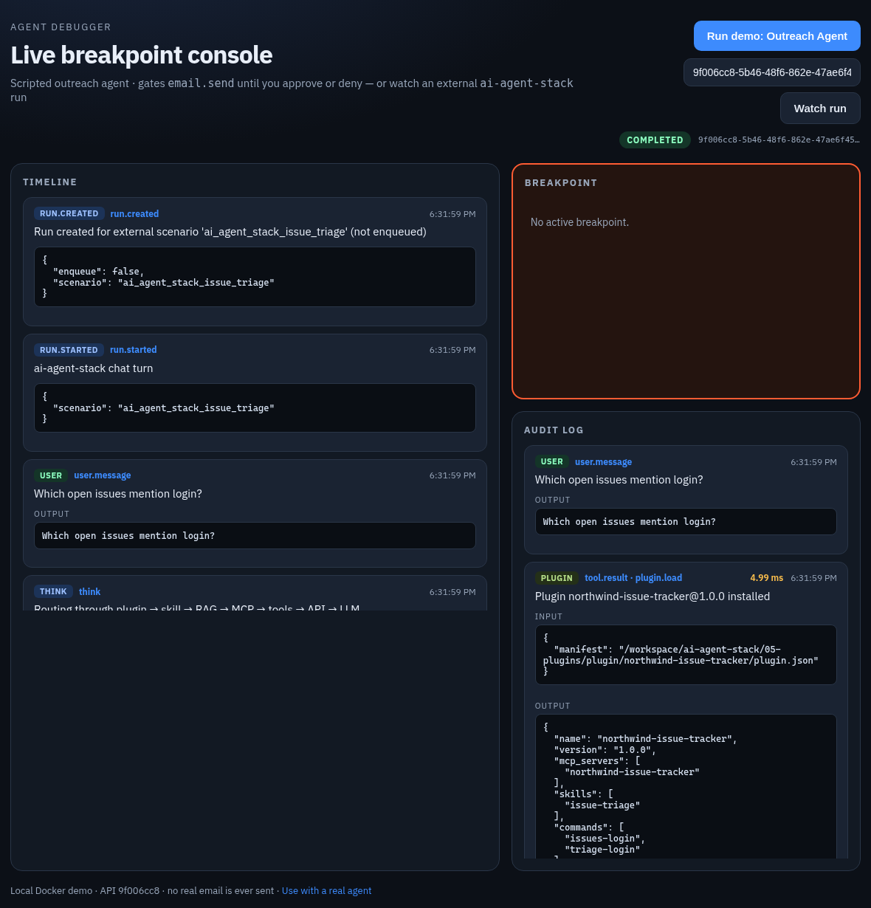
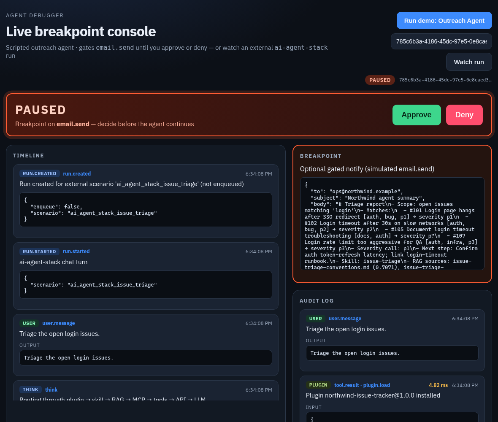

**Modules 01 to 06 each built one piece: an API, tools, RAG, an MCP server, a plugin and a skill. This last module wires them into one agent and answers one question with all of them. Every step is timed and recorded in agent-debugger, so you can see exactly what ran, with what input, and for how long. And if the agent wants to email the result, it stops and waits for you.**

In the [AI Agent Stack overview](/writing/ai-agent-stack-mcp-rag-apis-tools-plugins-skills/), I compared the six building blocks people mix up: APIs, tools, RAG, MCP, plugins and skills. [Module 01](/writing/ai-agent-stack-01-apis-setup/) set up the issue tracker API, and [Module 06](/writing/ai-agent-stack-06-skills-setup/) added the triage skill. This post puts everything together: [github.com/likarajo/ai-agent-stack/tree/main/07-integration](https://github.com/likarajo/ai-agent-stack/tree/main/07-integration).

The trace comes from [agent-debugger](https://github.com/likarajo/agent-debugger), the small open-source console I wrote about in [Breakpoints for AI Agents: Pause Before email.send](/writing/breakpoints-for-ai-agents-pause-before-email-send/).


## Watch the video

<!-- TODO: replace YOUTUBE_VIDEO_ID (2 places) once the video is public, or remove this section -->
<div class="video-embed" style="position:relative;width:100%;aspect-ratio:16/9;margin:1.25rem 0 0.5rem;overflow:hidden">
  <iframe
    src="https://www.youtube-nocookie.com/embed/YOUTUBE_VIDEO_ID"
    title="AI Agent Stack, Module 07: Integration — Likarajo Tech"
    loading="lazy"
    allow="accelerometer; autoplay; clipboard-write; encrypted-media; gyroscope; picture-in-picture; web-share"
    allowfullscreen
    referrerpolicy="strict-origin-when-cross-origin"
    style="position:absolute;inset:0;width:100%;height:100%;border:0"
  ></iframe>
</div>

<p><a href="https://youtu.be/YOUTUBE_VIDEO_ID">https://youtu.be/YOUTUBE_VIDEO_ID</a></p>

## 1. What it is

Module 07 is one function, `answer_question()`, with two front ends: a small web chat and a command-line script. For every question it runs the same seven steps, in this order:

| Step | What it does |
|------|--------------|
| `plugin.load` (Module 05) | Installs the `northwind-issue-tracker` plugin manifest |
| `skill.select` (Module 06) | Reads the skill catalog and picks `issue-triage` |
| `rag.retrieve` (Module 03) | Pulls the top 3 chunks from the team's docs |
| `mcp.search_issues_tool` (Module 04) | Searches open issues through the MCP server's tool |
| `tools.search_issues` (Module 02) | Runs the same search as a plain function tool |
| `api.get_issue` (Module 01) | Fetches the top issue's details |
| `llm.chat` | Writes the answer from everything above |

Each step is wrapped in a small debugger client that sends a `tool.call` event when the step starts and a `tool.result` event, with its input, output and `duration_ms`, when it ends. With `AGENT_DEBUGGER_URL` set, those events go to agent-debugger over HTTP. Without it, they stay in a local list that the chat app shows in its sidebar.

## 2. Why it matters

Each earlier module was easy to reason about on its own. Put six of them behind one answer and the questions change: which step found the issue ids? Which docs did the answer cite? Was the slow part retrieval or the model? Did the agent try to do anything with side effects?

You can't answer those from the final text. You need a record of every step, in order, with inputs, outputs and timings. That's what the debugger gives you here. And for the one step that reaches the outside world, sending an email, a record after the fact isn't enough, so the run stops and waits for a person.

That gives the rule of thumb for this module: **if you can't see every step, you can't trust the answer. Log every step, and gate the ones you can't take back.**

## 3. The running example

The chat app offers three demo questions as chips:

1. **"Which open issues mention login?"** The main example in this post.
2. **"How do we usually fix login timeouts?"** Leans on RAG and the runbook.
3. **"Triage the open login issues."** Uses the skill's report format, and is the one to try with email.

All three run the full set of seven steps. The data is the same Northwind sample data as every earlier module: the issue store, the three docs and the `issue-triage` skill.

## 4. Set it up

You need **Python 3.11 or newer** and git. For the debugger you also need **Docker**. There's no model and there are no API keys.

Clone the repo and create a virtual environment from the repo root (you can reuse the clone from the earlier modules):

```bash
git clone https://github.com/likarajo/ai-agent-stack.git
cd ai-agent-stack
python3 -m venv .venv
source .venv/bin/activate
pip install -r 07-integration/requirements.txt
```

This module needs the dependencies of the modules it calls, so the list is longer than before: FastAPI, Uvicorn, httpx, NumPy, the MCP Python SDK, PyYAML and pytest.

Then, in a **second terminal**, start agent-debugger from its own repo:

```bash
git clone https://github.com/likarajo/agent-debugger.git
cd agent-debugger
docker compose up --build
```

That starts the debugger console on `http://localhost:3000` and its API on `http://localhost:8000`.

## 5. Run it

Back in the `ai-agent-stack` terminal, start the chat app and point it at the debugger API:

```bash
AGENT_DEBUGGER_URL=http://127.0.0.1:8000 make chat
```

Open `http://127.0.0.1:8080` and click **"Which open issues mention login?"**. The answer appears in the main pane, and the sidebar shows the local trace with each step and its duration:


The answer:

```text
Found 4 open issue(s) matching the query (skill=issue-triage; sources=auth-design-notes.md, auth-design-notes.md, login-timeout-runbook.md):
- #101 Login page hangs after SSO redirect [auth, bug, p1]
- #102 Login timeout after 30s on slow networks [auth, bug, p2]
- #105 Document login timeout troubleshooting [docs, auth]
- #107 Login rate limit too aggressive for QA [auth, infra, p3]

Closest detail: #101 — Login page hangs after SSO redirect

—
stack: plugin=northwind-issue-tracker · skill=issue-triage · rag_chunks=3 · mcp=4 · tools=4
```

The same four issues as every earlier module. The last line tells you which piece contributed what.

The chat app also shows the run id. Open `http://localhost:3000`, paste the run id into the field next to **Watch run**, and the debugger fills in the timeline and the audit log:



For that one question, the debugger recorded 20 events. The audit log keeps 10 of them: the user message, the seven `tool.result` entries, the final answer and `run.completed`. Here are the step timings from that run:

| Audit entry | Duration |
|-------------|----------|
| `plugin.load` | 4.15 ms |
| `skill.select` | 3.42 ms |
| `rag.retrieve` | 3.85 ms |
| `mcp.search_issues_tool` | 2.88 ms |
| `tools.search_issues` | 2.62 ms |
| `api.get_issue` | 2.97 ms |
| `llm.chat` | 2.63 ms |
| Whole turn | 58.36 ms |

Your timings will differ. They're also not the whole story: on a fresh command-line run, the whole turn took 566.45 ms while the seven steps added up to about 41 ms. Most of the gap, about 430 ms, sat between the RAG result and the MCP call. That's Python importing the MCP SDK and server code, which happens before the MCP step's timer starts. The trace made that visible; the step durations alone would have hidden it.

You can do the same from the command line, without the chat app:

```bash
AGENT_DEBUGGER_URL=http://127.0.0.1:8000 SKIP_MODEL=1 python 07-integration/integration/pipeline.py --question "Which open issues mention login?"
```

It prints the same answer, followed by the run id and the total duration.

## The email gate

Now ask for something with a side effect. Either add `--email` on the command line, or put "email" or "notify" in the question:

```bash
AGENT_DEBUGGER_URL=http://127.0.0.1:8000 SKIP_MODEL=1 python 07-integration/integration/pipeline.py --question "Triage the open login issues." --email
```

After the seven steps and the triage report, the agent calls `email.send`. agent-debugger has `email.send` on its list of gated tools, so the run pauses and the script waits:



The payload is right there: who it would go to, the subject and the full body. Then you decide:


- **Approve.** The debugger records `Human approved email.send` and `Approved — tool allowed to proceed (demo: no real send)`, the script prints the triage report, and the run ends with `run.completed`.
- **Deny.** The debugger records the decision and `Run aborted after deny — email was not sent`, and the run is closed.

Either way, no email goes out. The "send" is a function, `simulate_email_send`, that only returns a note saying nothing was sent. The point is the pause and the record, not the email.

## 6. How it works inside

There are three files to read, in this order:

1. **`shared/debugger.py`** is the debugger client. Its `step()` context manager is what makes every step show up with a timing:

   ```python
   started = time.perf_counter()
   call = self.emit("tool.call", tool=tool, message=message, payload=call_payload)
   bag = {"call": call, "output": None, "message": None}
   try:
       yield bag
   finally:
       duration_ms = round((time.perf_counter() - started) * 1000, 2)
       ...
       self.emit("tool.result", tool=tool, message=..., payload=result_payload)
   ```

   `emit()` posts to `/runs/{id}/events` when `AGENT_DEBUGGER_URL` is set, and appends to `local_events` either way. For a gated tool like `email.send`, `tool_call()` posts the event and then blocks on `GET /runs/{id}/wait-decision` until you decide.

2. **`07-integration/integration/pipeline.py`** has `answer_question()`, which calls the seven steps in order. Each one is a few lines inside `with dbg.step(...)`. Two of them take a shortcut worth knowing about: the MCP step imports the server's `search_issues_tool` function and calls it directly instead of starting the server over stdio as Module 04 did, and the API step reads from the shared issue store instead of making an HTTP request to the Module 01 server. Both keep the demo self-contained; the trace still records them as the MCP and API steps.

3. **`07-integration/integration/chat_app.py`** is the web chat: a FastAPI app with `POST /api/chat`, which calls `answer_question()` and returns the answer, the run id and the local events for the sidebar.


About the LLM step: with `SKIP_MODEL=1`, which every command in this post uses, `llm.chat` composes the answer from a template instead of calling a model, and its tool.result says so: "Scripted answer composed (no live model)". The step still records the configured model name (`qwen2.5:0.5b`, the local Ollama default), so don't read that as proof a model ran. Without `SKIP_MODEL`, the pipeline uses a local Ollama model if one is available. I only ran the scripted path for this post.

## 7. Test it

The tests don't need a model or the debugger:

```bash
pytest 07-integration/tests -p no:warnings
```

```text
...........                                                              [100%]
11 passed in 0.59s
```

(`-p no:warnings` only hides a dependency warning so the result is easy to read. The tests pass either way, and the timing will differ on your machine.)

The 11 tests check that the gated tools match agent-debugger's policy, that the chat app's endpoints answer, that a full model-free run records all seven steps with a duration for each, and that the debugger client sends the trace, including an approved `email.send`, to a fake debugger API. None of them tests the Deny path.

## What's next

That's the whole stack: an API, tools, RAG, MCP, a plugin and a skill, working together on one question, with every step on the record and a person in the loop before anything leaves the machine. From here, the most useful next step is to swap in your own pieces, your own API, docs or skill, and keep the trace on while you do.

If you only take one idea from this series, take the one from [Breakpoints for AI Agents](/writing/breakpoints-for-ai-agents-pause-before-email-send/): let the agent run the steps you can undo, and make it stop before the ones you can't.

Code: [github.com/likarajo/ai-agent-stack/tree/main/07-integration](https://github.com/likarajo/ai-agent-stack/tree/main/07-integration)
