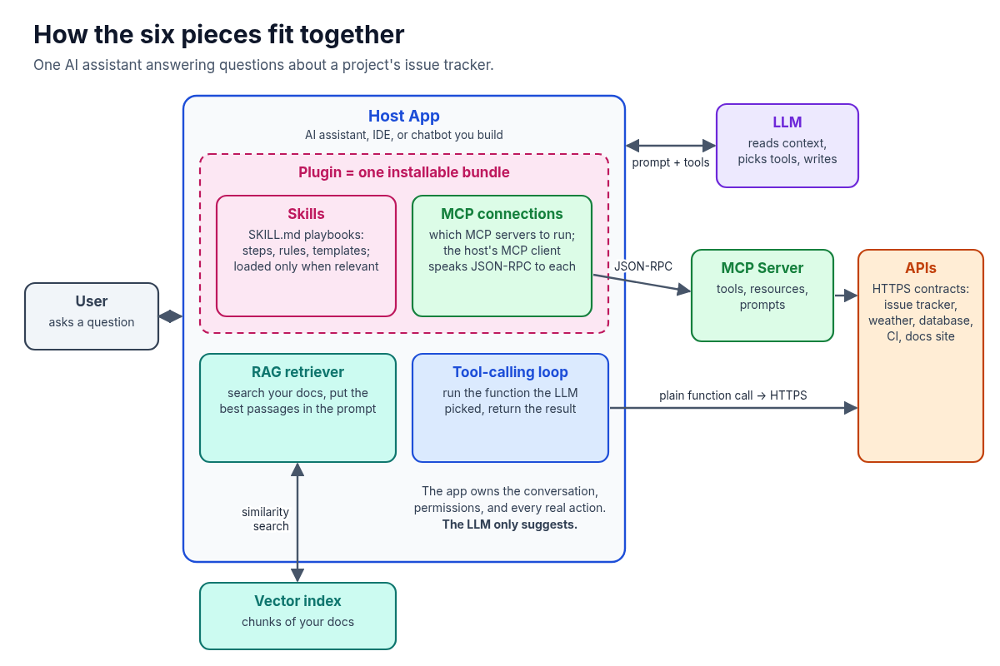
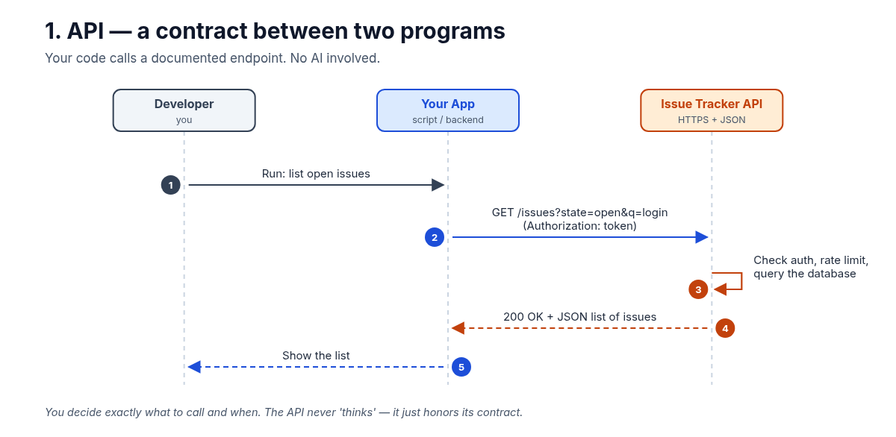
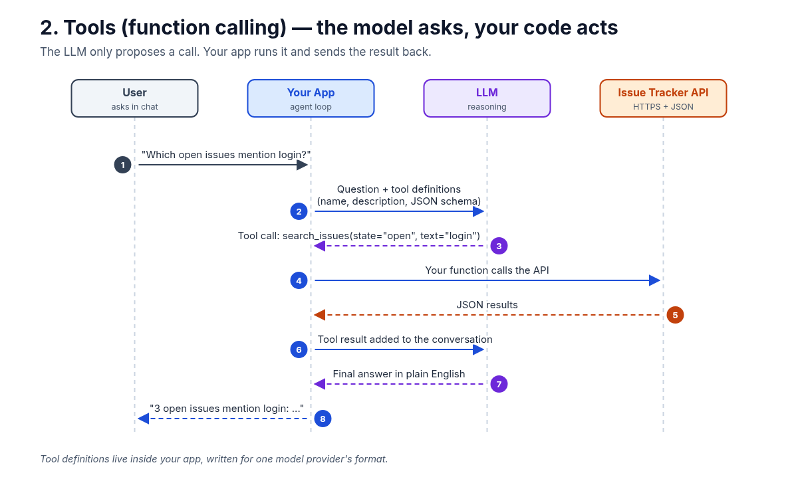
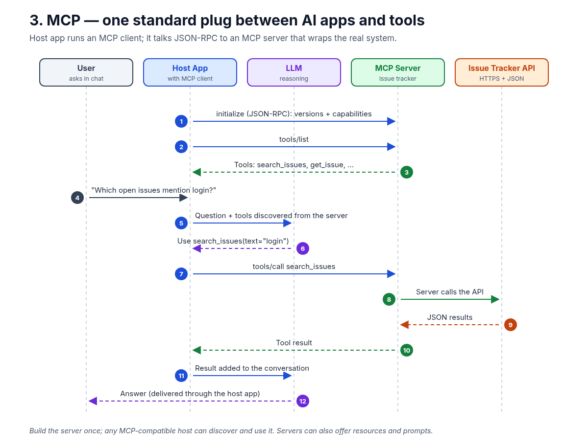
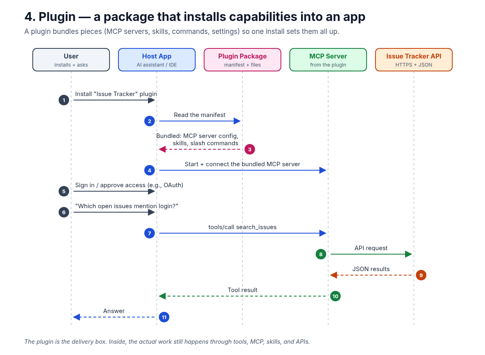
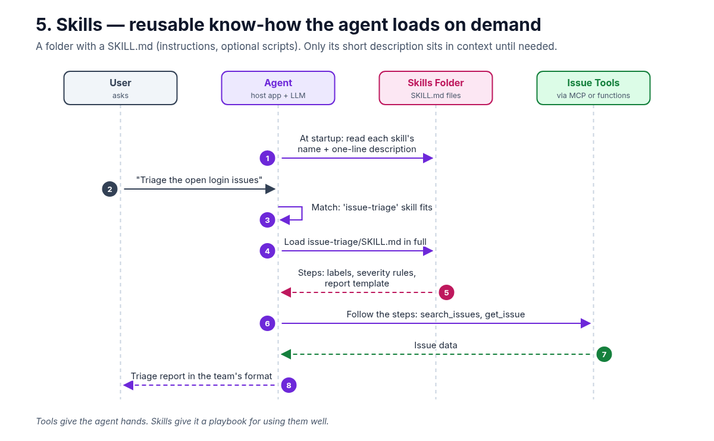
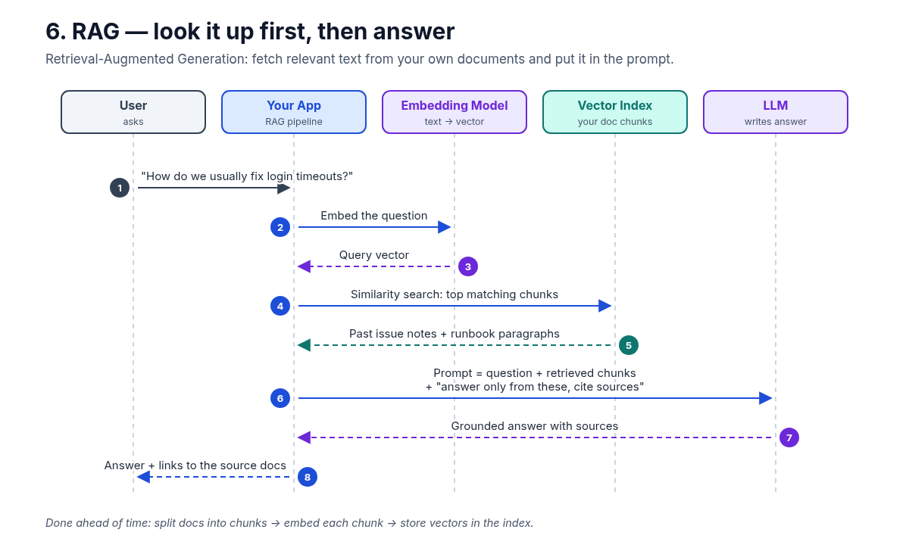
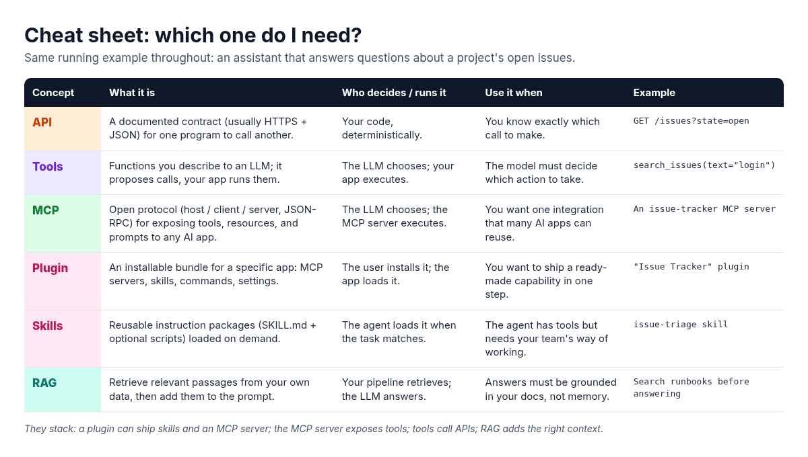

**A plain-English guide for new developers: what each one is, when to use it, and a flowchart showing how the messages actually move.**

If you've started building with AI recently, you've probably seen these six words used as if they mean the same thing: API, tools, MCP, plugins, skills, RAG. They don't. Each one solves a different problem, and once you see where each one sits, AI agent architecture gets a lot less confusing.

To keep things concrete, I'll use one running example the whole way through: **an AI assistant that answers questions about a software project's issue tracker**, like "Which open issues mention login?" Same question, six different building blocks.

Here's the big picture first. Then we'll go one piece at a time.

## 1. API: the contract underneath everything

An **API (Application Programming Interface)** is a documented contract that lets one program talk to another. For web services that usually means HTTPS requests and JSON responses: you send a request to an endpoint, and you get back data in a format the docs promise.

**What it's used for:** Any time software needs data or an action from another system. APIs existed long before LLMs, and they're still where the real work happens.

**How the communication flows:**

1. You ask your app to list open issues about login.
2. Your app sends a request like GET /issues?state=open&q=login, with an access token.
3. The issue tracker checks your permissions and runs the query.
4. It returns a JSON list of issues.
5. Your app shows the list.

**Key point:** There's no AI here. You decide exactly which call to make and when. Everything else in this article ends up calling an API somewhere.

## 2. Tools (function calling): the model asks, your code acts

**Tools** (often called function calling or tool use) let an LLM *request* an action. You describe functions to the model: a name, a plain-English description, and a JSON schema for the inputs. When the model decides a function would help, it replies with a structured tool call instead of text.

The part beginners often miss: **the model doesn't run anything.** Your application runs the function, then sends the result back so the model can finish its answer.

**How the communication flows:**

1. The user asks, "Which open issues mention login?"
2. Your app sends the question to the LLM along with the tool definitions.
3. The LLM replies with a tool call: search_issues(state="open", text="login").
4. Your function calls the issue tracker API.
5. The API returns JSON.
6. Your app adds the result to the conversation.
7. The LLM writes the final answer in plain English.
8. Your app shows it to the user.

**Use tools when** you don't know ahead of time which action is needed and you want the model to choose, while your code keeps control of what actually runs.

## 3. MCP: one standard plug between AI apps and tools

The **Model Context Protocol (MCP)** is an open protocol, introduced by Anthropic, that standardizes how AI applications connect to external tools and data. A common analogy is a USB-C port for AI apps: build the connector once, and any compatible app can use it.

MCP has three roles:

- **Host:** the AI application the user works in (a chat app, an IDE, your own agent).
- **Client:** the component inside the host that keeps a connection to one MCP server.
- **Server:** a program that wraps a real system (here, the issue tracker) and exposes its capabilities.

Clients and servers exchange **JSON-RPC** messages. A server can offer **tools** (actions the model can call), **resources** (data the app can read), and **prompts** (reusable templates).

**How the communication flows:**

1. The host's MCP client connects and runs an initialize handshake to agree on protocol version and capabilities.
2. The client sends tools/list.
3. The server replies with its tools, such as search_issues and get_issue.
4. The user asks the question.
5. The host sends the question plus the discovered tools to the LLM.
6. The LLM picks search_issues.
7. The client sends tools/call to the MCP server.
8. The server calls the issue tracker API.
9. The API returns JSON.
10. The server returns the tool result to the client.
11. The host adds the result to the conversation.
12. The LLM's answer goes back to the user through the host.

**How is this different from plain tools?** With plain function calling, tool definitions live inside one app, often written for one model provider's format. With MCP, the integration lives in a separate server that any MCP-compatible host can discover and reuse. MCP doesn't replace tool calling. It standardizes how tools are found and invoked.

## 4. Plugins: the delivery box

A **plugin** is a packaged extension for a specific application. In today's AI apps and IDEs, a plugin usually bundles several pieces into one install: MCP server configurations, skills, slash commands, settings, and sometimes UI. The exact format depends on the app.

**What it's used for:** Shipping a ready-made capability so users don't have to wire each part up by hand.

**How the communication flows:**

1. The user installs an "Issue Tracker" plugin.
2. The host reads the plugin's manifest.
3. The manifest lists what's bundled: an MCP server config, skills, and commands.
4. The host starts and connects the bundled MCP server.
5. The user signs in or approves access to their account (for example, with OAuth).
6. The user asks the question.
7. The host calls the tool through MCP.
8. The MCP server calls the API.
9. The API returns JSON.
10. The server returns the tool result.
11. The user gets the answer.

**Key point:** A plugin is about packaging and distribution, not a new way of communicating. Once it's installed, the actual work still flows through tools, MCP, skills, and APIs.

## 5. Skills: reusable know-how, loaded on demand

Tools give an agent hands. **Skills** give it a playbook. A skill is usually a folder with a SKILL.md file: a short name and description at the top, then step-by-step instructions, rules, templates, and sometimes helper scripts or reference files.

The clever part is **progressive loading**. At startup, the agent sees only each skill's name and one-line description. It loads the full instructions only when a task matches, which keeps the context window small even when you have dozens of skills.

**How the communication flows:**

1. At startup, the agent reads each skill's name and description.
2. The user asks, "Triage the open login issues."
3. The agent decides the issue-triage skill fits.
4. It loads issue-triage/SKILL.md in full.
5. The skill provides the steps: labeling rules, severity guidelines, a report template.
6. The agent follows those steps, calling tools like search_issues and get_issue.
7. The tools return issue data.
8. The user gets a triage report in the team's format.

**Use skills when** the agent can already *do* things but needs to do them *your way*: your conventions, your checklists, your output format.

## 6. RAG: look it up first, then answer

**RAG (Retrieval-Augmented Generation)** gives an LLM relevant information from your own data at question time. The model doesn't learn anything new. You find the right passages and put them in the prompt.

There are two phases. **Ahead of time**, you split your documents (runbooks, past issue discussions, design docs) into chunks, turn each chunk into a vector with an embedding model, and store the vectors in an index. **At question time**:

1. The user asks, "How do we usually fix login timeouts?"
2. The app sends the question to an embedding model.
3. It gets back a query vector.
4. The app runs a similarity search against the vector index.
5. The index returns the most relevant chunks: past issue notes and runbook paragraphs.
6. The app builds a prompt with the question, the retrieved chunks, and an instruction to answer only from them and cite sources.
7. The LLM returns a grounded answer with sources.
8. The user gets the answer plus links to the source documents.

**Use RAG when** answers need to come from *your* knowledge (internal docs, policies, past decisions) and you want them traceable to a source. Retrieval can also use keyword search or a mix of methods. Vectors are just the most common approach.

**RAG vs tools, in one line:** RAG brings *knowledge* into the prompt. Tools let the model *take actions* or fetch live data. Many real systems use both.

## The cheat sheet

| Concept | What it is | Who decides / runs it | Use it when | Example |
| --- | --- | --- | --- | --- |
| **API** | A documented contract (usually HTTPS + JSON) for one program to call another. | Your code, deterministically. | You know exactly which call to make. | `GET /issues?state=open` |
| **Tools** | Functions you describe to an LLM; it proposes calls, your app runs them. | The LLM chooses; your app executes. | The model must decide which action to take. | `search_issues(text="login")` |
| **MCP** | Open protocol (host / client / server, JSON-RPC) for exposing tools, resources, and prompts to any AI app. | The LLM chooses; the MCP server executes. | You want one integration that many AI apps can reuse. | An issue-tracker MCP server |
| **Plugin** | An installable bundle for a specific app: MCP servers, skills, commands, settings. | The user installs it; the app loads it. | You want to ship a ready-made capability in one step. | "Issue Tracker" plugin |
| **Skills** | Reusable instruction packages (SKILL.md + optional scripts) loaded on demand. | The agent loads it when the task matches. | The agent has tools but needs your team's way of working. | `issue-triage` skill |
| **RAG** | Retrieve relevant passages from your own data, then add them to the prompt. | Your pipeline retrieves; the LLM answers. | Answers must be grounded in your docs, not memory. | Search runbooks before answering |

If you remember one thing, make it this: **they stack, they don't compete.**

- **API** is the contract with the real system.
- **Tools** let the model ask your code to call that API.
- **MCP** standardizes how tools (plus resources and prompts) are exposed, so many apps can reuse one integration.
- **Plugins** package MCP servers, skills, and commands into a single install.
- **Skills** teach the agent how your team wants the work done.
- **RAG** makes sure the model is working from the right context.

## A quick decision guide

- Need to call one known endpoint from regular code? **Use the API directly.**
- Want the model to choose between a few actions in your own app? **Define tools.**
- Want the same integration to work across several AI apps or IDEs? **Build an MCP server.**
- Want other people to install your setup in one step? **Ship a plugin.**
- Keep explaining the same procedure to your agent? **Write a skill.**
- Need answers grounded in your own documents? **Add RAG.**

One habit worth building early: whichever pieces you use, **keep permissions and final actions in your application code.** The model proposes. Your system decides what's allowed.

Which of these six confused you most when you started, and which one are you building with right now? I'd love to hear in the comments.

#AI #MCP #RAG #AIAgents #SoftwareEngineering
