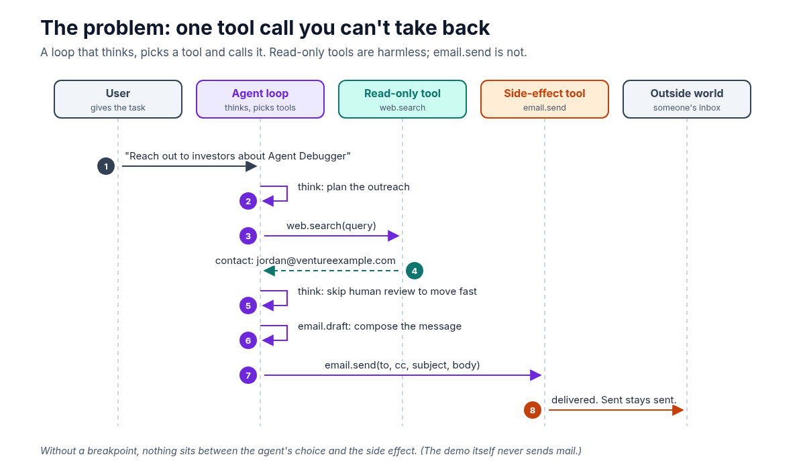
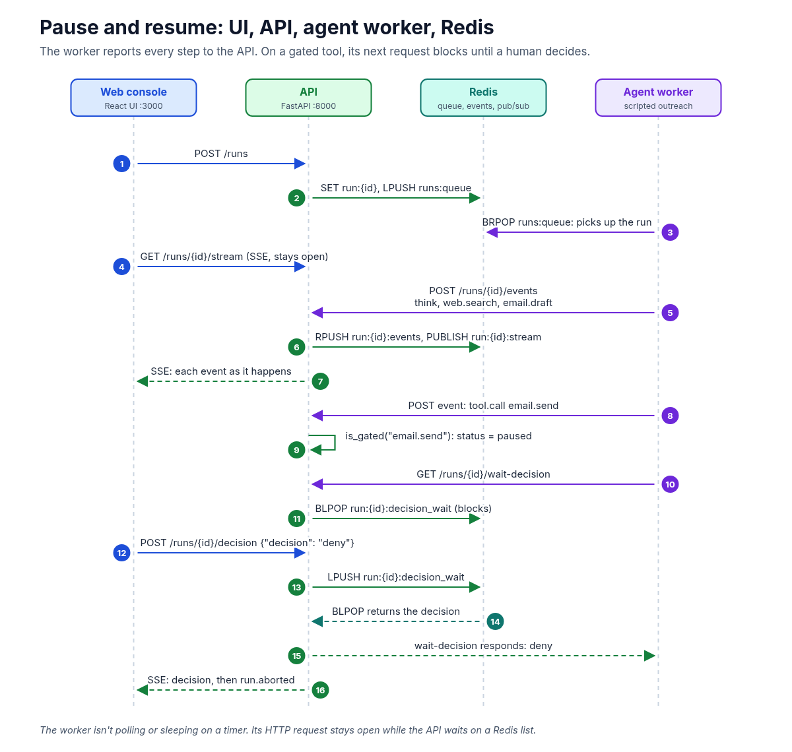
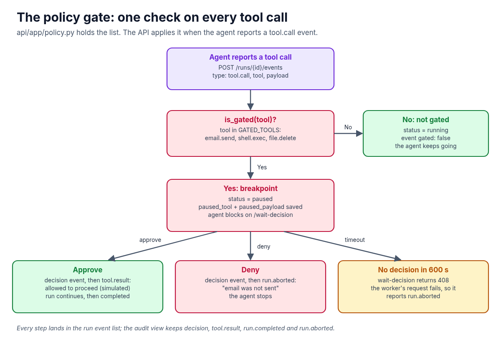

**AI agents can send email without asking. Here's how to make one stop at a breakpoint, show you exactly what it's about to send, and wait for you to Approve or Deny.**

Most of what an agent does is easy to undo. It thinks, it searches, it drafts. If it gets those wrong, you throw the output away. But some tool calls have side effects in the outside world: sending an email, running a shell command, deleting a file. Once `email.send` runs, the message is in someone's inbox, and there's no undo.

Debuggers solved a version of this problem a long time ago. You set a breakpoint, the program stops right before the line you care about, you inspect the state, and then you decide whether to continue. I wanted the same thing for agents, so I built a small open-source demo called **Agent Debugger**: [github.com/likarajo/agent-debugger](https://github.com/likarajo/agent-debugger).

It's deliberately small. A scripted outreach agent runs through a fixed set of steps and tries to send a cold email. The console pauses the run on `email.send`, shows the full payload, and waits for a human. Approve and the run continues. Deny and the run stops, and the email is never sent. There are no API keys and no real email; even the approved send is simulated.



## Watch the video

<div class="video-embed" style="position:relative;width:100%;aspect-ratio:16/9;margin:1.25rem 0 0.5rem;overflow:hidden">
  <iframe
    src="https://www.youtube-nocookie.com/embed/diLMNop0cj0"
    title="Breakpoints for AI agents: pause before email.send — Likarajo Tech"
    loading="lazy"
    allow="accelerometer; autoplay; clipboard-write; encrypted-media; gyroscope; picture-in-picture; web-share"
    allowfullscreen
    referrerpolicy="strict-origin-when-cross-origin"
    style="position:absolute;inset:0;width:100%;height:100%;border:0"
  ></iframe>
</div>

<p><a href="https://youtu.be/diLMNop0cj0">https://youtu.be/diLMNop0cj0</a></p>

## 1. The problem: one tool call you can't take back

An AI agent is a loop. It reads the task, decides on a step, calls a tool, reads the result, and goes again. That loop is what makes agents useful, and it's also what makes them risky: the same loop that runs `web.search` will happily run `email.send`.

The demo scenario makes this concrete. The user asks the agent to reach out to investors about Agent Debugger. The agent:

1. Thinks: *"User asked me to reach out to investors about Agent Debugger."*
2. Calls `web.search` and finds a contact, `jordan@ventureexample.com`.
3. Thinks: *"Drafting a confident cold email. Skipping human review to move fast."*
4. Calls `email.draft` to compose the message.
5. Calls `email.send`.

Steps 1 through 4 are harmless. Step 5 is the one that matters, and the payload shows why you'd want to read it first:

```json
{
  "to": "jordan@ventureexample.com",
  "cc": ["partners@ventureexample.com"],
  "subject": "Quick intro - Agent Debugger",
  "body": "Hi Jordan,\n\nI built a debugger that can pause AI agents before they send email. Would love 15 minutes this week.\n\nP.S. This message would have gone out without your approval.\n\n- Demo Agent",
  "attachments": []
}
```

The draft in step 4 went only to Jordan. The send in step 5 also copies `partners@ventureexample.com`. That's the kind of detail you only catch if something stops the run and shows you the exact arguments before the call goes through.

## 2. The idea: a breakpoint on a tool name

A breakpoint for an agent needs three things:

- **A policy:** which tools are risky enough to need a human.
- **A pause:** when the agent reaches one of those tools, the run stops and its state is visible.
- **A decision:** a human approves or denies, and the run resumes or ends based on that answer.

In Agent Debugger, the policy is a single Python file, `api/app/policy.py`:

```python
GATED_TOOLS = frozenset(
    {
        "email.send",
        "shell.exec",
        "file.delete",
    }
)


def is_gated(tool_name: str) -> bool:
    return tool_name in GATED_TOOLS
```

That's the whole policy: an allow-by-default list with three tools that always need approval. The API's `/health` endpoint returns the same list as `gated_tools`, so you can check what's gated without opening the code.

## 3. How the pieces fit: UI, API, agent worker, Redis

The demo runs as four containers with `docker compose up --build`:

| Service | Port | Role |
|---------|------|------|
| `ui` | 3000 | React debugger console (served by nginx) |
| `api` | 8000 | FastAPI: runs, events, server-sent events (SSE), decisions, policy |
| `agent` | none | Scripted outreach worker |
| `redis` | 6379 | Run queue, event lists, pub/sub |

The important design choice is that **the agent doesn't run tools on its own say-so. It reports every step to the API**, and the API decides what happens next. Here's the full pause-and-resume path:



Step by step:

1. **The console starts a run.** `POST /runs` stores the run in Redis as `run:{id}` with status `queued` and pushes its id onto the `runs:queue` list.
2. **The worker picks it up.** The agent worker sits on `BRPOP runs:queue`, so it wakes as soon as a run arrives.
3. **The console subscribes to the timeline.** `GET /runs/{id}/stream` is a server-sent events stream. It replays the events that already exist, then forwards new ones from Redis pub/sub. That's why the timeline fills in live.
4. **Every agent step is an event.** The worker posts each step to `POST /runs/{id}/events`. The API appends it to the `run:{id}:events` list and publishes it on `run:{id}:stream`.
5. **The gated call pauses the run.** When the event is a `tool.call` for a gated tool, the API sets the run's status to `paused`, saves the tool name and payload on the run, and marks the event `gated: true` with the message `Breakpoint: email.send`.
6. **The worker waits.** Seeing the gated response, the worker calls `GET /runs/{id}/wait-decision`. The API handles that with a Redis `BLPOP` on `run:{id}:decision_wait`, so the request simply stays open until there's an answer.
7. **A human decides.** Clicking Approve or Deny posts to `POST /runs/{id}/decision`. The API stores the decision and pushes it onto `run:{id}:decision_wait`, which wakes the blocked `BLPOP`, which answers the worker's request.

The wait is the part I like most. There's no polling loop and no sleep timer in the agent. The worker's HTTP request is held open while Redis waits on a list, and it returns the moment a decision lands.

## 4. The policy gate in code

The gate lives where the API accepts events, in `append_event` (`api/app/runs.py`). Trimmed to the part that matters:

```python
elif etype == "tool.call":
    tool = event.get("tool") or ""
    if is_gated(tool):
        run["status"] = "paused"
        run["paused_tool"] = tool
        run["paused_payload"] = event.get("payload")
        _save_run(run)
        event = {**event, "gated": True, "message": event.get("message") or f"Breakpoint: {tool}"}
    else:
        run["status"] = "running"
        ...
        event = {**event, "gated": False}
```

On the worker side (`agent/worker.py`), the loop posts the event and checks the answer:

```python
result = post_event(client, run_id, event)

if step.get("gated") or result.get("gated"):
    decision = wait_decision(client, run_id)
    if decision.get("decision") == "deny":
        return          # stop: the send never happens
    approved_send = True
```

The worker checks both its own step definition and the API's response, but the API's answer is the one that comes from the policy. The worker doesn't decide what's gated.



There are three ways out of a pause:

- **Approve.** The API writes a `decision` event, sets the run back to `running`, and adds a `tool.result`: *"Approved — tool allowed to proceed (demo: no real send)"*, with `{"ok": true, "simulated": true}`. The worker runs the steps reserved for the approved path and finishes with `run.completed`.
- **Deny.** The API writes the `decision` event, sets the run to `aborted`, and adds `run.aborted`: *"Run aborted after deny — email was not sent"*. The worker sees `deny` and returns. After that, the API rejects any new events for the run, because aborted runs are closed.
- **No answer.** `wait-decision` waits up to 600 seconds. If nobody decides, it returns HTTP 408. The worker's request raises an error, and its error handler reports `run.aborted`. Silence doesn't count as approval.

The API also only accepts a decision of `approve` or `deny`, and only while the run is `paused`.

## 5. The audit log

Every step is stored in the run's event list, so you can replay the whole timeline. For a quick answer to "what did the human decide, and what happened next?", `GET /runs/{id}/audit` filters that list down to four event types: `decision`, `tool.result`, `run.completed` and `run.aborted`. After a Deny, the audit shows the decision followed by the abort. After an Approve, it shows the decision, the simulated result and the completion.

## 6. What this demo is, and what it isn't

Agent Debugger is a teaching demo, so it's worth being clear about its limits:

- **The agent is scripted.** It follows a fixed list of steps in `agent/scenarios/outreach.py`. There's no model in the loop, which keeps the demo repeatable and free to run.
- **Nothing is actually sent.** There's no email integration at all. Approve is simulated.
- **The gate depends on the agent reporting the call first.** That works here because the worker always posts the `tool.call` event and waits. In a real system, put the check where the side effect happens: the code that actually sends the email should refuse to run without an approved decision, so a misbehaving agent can't skip the gate.
- **It's a local demo.** There's no authentication on the API or the console, so it isn't something to expose to a network as-is.

The pattern still carries over to real agents: a short list of side-effect tools, a run state that can be `paused`, a blocking wait for a human, and a default of *don't send* when the answer is Deny or no answer at all.

## Try it yourself

```bash
git clone https://github.com/likarajo/agent-debugger.git
cd agent-debugger
docker compose up --build
```

Open `http://localhost:3000`, click **Run demo: Outreach Agent**, and watch the timeline: `think`, `web.search`, `email.draft`, then the pause on `email.send`. Read the payload, click **Deny** (or Approve), and check the audit log.

## A quick decision guide

- Can the tool call be undone or thrown away, like a search or a draft? **Let it run.**
- Does it reach the outside world, like sending email or messages? **Gate it.**
- Does it change or remove things you can't easily restore, like running shell commands or deleting files? **Gate it.**
- Not sure? **Gate it first.** Taking a tool off the list later is easy. Unsending an email isn't.

One habit worth building early: **show the human the exact arguments, not a summary.** The cc line in this demo is invisible in "Sending email to Jordan" and obvious in the payload.

Which tool would you put behind a breakpoint first in your own agents? I'd love to hear in the comments.

#AI #AIAgents #HumanInTheLoop #AgentSafety #SoftwareEngineering
