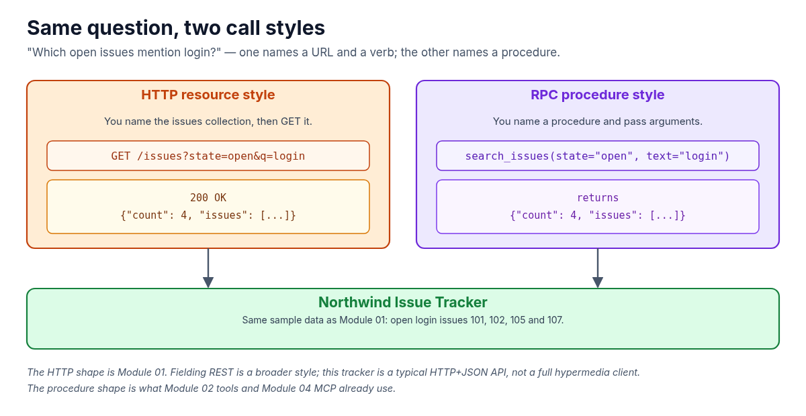
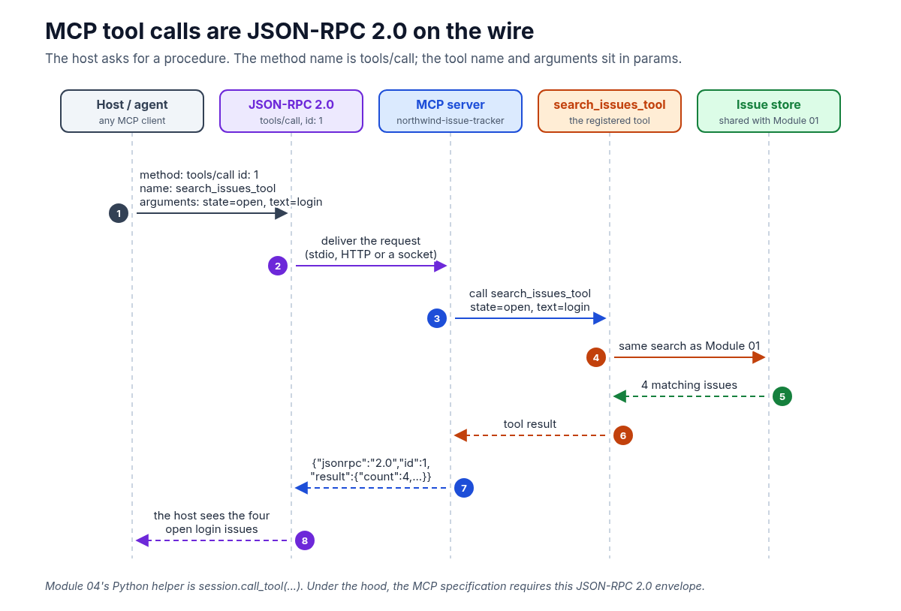
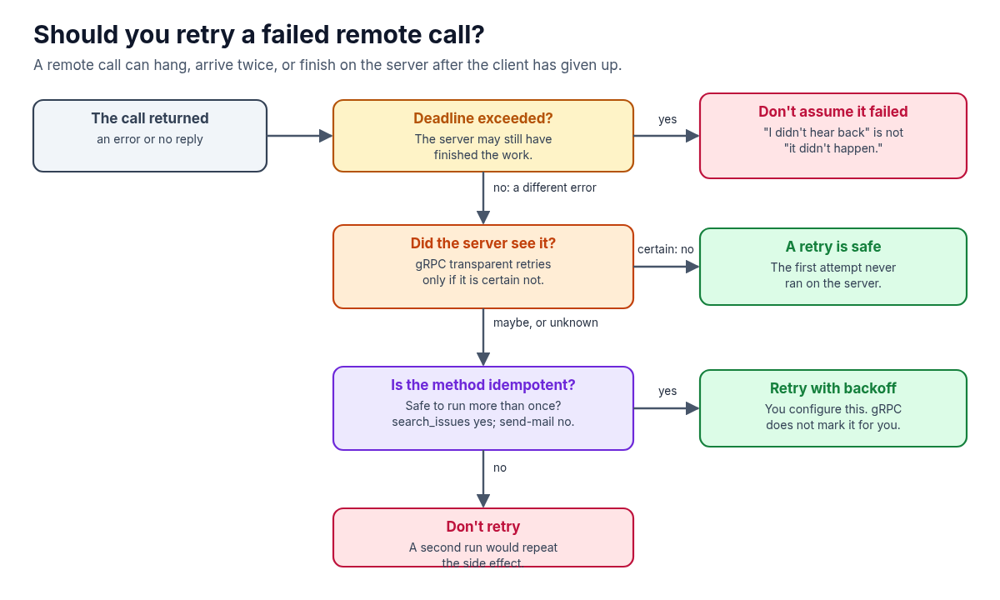

**Ask an issue tracker which open tickets mention login, and you can do it two ways. One names a URL: `GET /issues?state=open&q=login`. The other names a procedure: `search_issues(state="open", text="login")`. That second style is a remote procedure call, or RPC. If you've used MCP or function-calling tools, you've already been speaking it.**

In the [AI Agent Stack overview](/writing/ai-agent-stack-mcp-rag-apis-tools-plugins-skills/), I compared the six building blocks people mix up: APIs, tools, RAG, MCP, plugins and skills. [Module 01](/writing/ai-agent-stack-01-apis-setup/) starts with the HTTP API underneath: a small Northwind Issue Tracker you query with a URL. This article is a companion to that series. It stays with the same question, and shows the other call style: a function on another machine.



## 1. What RPC is

An **RPC** makes a call on another machine look like a local function. You write `search_issues(...)`, and some infrastructure packages the arguments, sends them over the network, runs the procedure on the server, and brings the result back.

That idea is old. In 1984, Andrew Birrell and Bruce Nelson described RPC as a way for programs written in a high-level language to talk across a network, and they walked through how to implement it: the client- and server-side structure, how a client finds a server, and the protocol underneath.

The HTTP style in Module 01 works the other way around. You name a *resource* (the issues collection) and use an HTTP verb (`GET`). Roy Fielding called the broader architectural style behind this **REST**: resources, representations, and a uniform interface. A typical HTTP+JSON API, including the issue tracker, is in that family. It isn't a complete Fielding-REST system (there's no hypermedia telling the client what to do next), and I won't pretend otherwise. The useful contrast is simpler: **URLs and verbs** versus **procedure names and arguments**.

Same question. Same four open login issues in the sample data (101, 102, 105 and 107). Different contract.

## 2. Stubs and serialization

The trick that makes `search_issues(...)` look local is a **stub**. On the client, a stub is an object that exposes the same methods as the remote service. Your code calls the stub. The stub does the unglamorous work: it **serializes** (packs) the arguments into bytes, sends them, waits, and unpacks the reply. On the server, a matching stub unpacks the request, dispatches it to your real function, and packs the result.


Two decisions sit in that path: how you describe the methods, and how you pack the data. gRPC's default answer to both is Protocol Buffers. JSON-RPC's answer is a small JSON envelope, with no separate interface language required.

A local call can throw. A remote call can also hang, arrive twice, or finish on the server after the client has given up. The stub hides the packing. It does not hide those failures, and it shouldn't.

## 3. gRPC and Protocol Buffers

**gRPC** is a modern RPC system. You define a service: the methods that can be called remotely, and the types they take and return. By default, that definition and the payload format are **Protocol Buffers**, written in a `.proto` file. A compiler generates client and server code. You call the generated stub; you implement the server methods.

A sketch of the same search, not a file in the AI Agent Stack repo, looks like this:

```proto
service IssueTracker {
  rpc SearchIssues (SearchIssuesRequest) returns (SearchIssuesResponse);
}

message SearchIssuesRequest {
  string state = 1;
  string text = 2;
}
```

The official Protocol Buffers overview describes the format as language-neutral and platform-neutral, "like JSON, except it's smaller and faster." I won't invent size or speed numbers on top of that. The `.proto` is also a contract: fields have numbers, and you can add fields later without breaking old clients, as long as you follow the compatibility rules in those docs.

gRPC is not only a one-request, one-response call. It also defines server streaming, client streaming, and bidirectional streaming. If you need a typed, generated client between services, and especially if you need a stream, gRPC is the usual choice. It is heavier than a JSON envelope, and the payloads are not self-describing without the `.proto`.

## 4. JSON-RPC, and why MCP speaks it

**JSON-RPC 2.0** is a lightweight RPC protocol. It is transport-agnostic: the same request can ride on HTTP, on a socket, or on stdio. A request is a JSON object with four familiar fields:

```json
{
  "jsonrpc": "2.0",
  "method": "search_issues",
  "params": {"state": "open", "text": "login"},
  "id": 1
}
```

`"jsonrpc": "2.0"` marks the version. `method` is the procedure name. `params` is optional. `id` lets the client match the reply to the call. Leave `id` off and it becomes a **notification**: the server must not send a response.

That envelope is what [MCP (Model Context Protocol)](/writing/ai-agent-stack-04-mcp-setup/) uses. The MCP specification says all messages between clients and servers must follow JSON-RPC 2.0. When a host calls a tool, the method on the wire is `tools/call`. The tool name and its arguments sit in `params`.

```json
{
  "jsonrpc": "2.0",
  "id": 1,
  "method": "tools/call",
  "params": {
    "name": "search_issues_tool",
    "arguments": {"state": "open", "text": "login"}
  }
}
```

In [Module 02](/writing/ai-agent-stack-02-tools-setup/), the model already proposes a procedure, `search_issues(state="open", text="login")`, and your code decides whether to run it. Module 04 lifts that same call into an MCP server any compatible host can discover. The Python SDK helper is `session.call_tool(...)`. Under the hood, it is this JSON-RPC request.



So the stack is not "APIs versus RPC." Module 01's HTTP API is the resource underneath. Tools and MCP are how an agent asks for a procedure. MCP standardizes that ask as JSON-RPC, so you write the server once and reuse it across hosts.

## 5. When the call fails

A remote call can fail in ways `search_issues()` in the same process cannot.

**Timeouts.** gRPC lets the client set a **deadline**: how long it is willing to wait. After that, the call ends with `DEADLINE_EXCEEDED`. By default gRPC sets no deadline, so a client can wait indefinitely; the docs say to always set a realistic one. The server and the client can also disagree. The server may have finished the work, then the response may arrive after the client's deadline. "I didn't hear back" is not the same as "it didn't happen."

**Retries and idempotency.** Retrying a failed call is safe only when doing the work twice doesn't change the result, or when you know the server never saw the first attempt. gRPC will do a limited "transparent retry" when it is certain the server has not processed the call. A broader retry policy is something you configure, and the gRPC retry proposal is clear: be more aggressive only when the method is **idempotent** (safe to run more than once) or the error guarantees the request was not processed. gRPC does not mark methods as idempotent for you. You have to know.

HTTP already has this language. RFC 9110 says an idempotent method can be retried automatically. `GET` is idempotent, so retrying Module 01's `GET /issues?...` is safer than retrying a typical "create issue" call. `search_issues` is a read, so the same rule applies. A tool that sends mail or writes a payment is not.



## 6. Which style should you use?

A short decision guide, not a ranking.

| If you... | Reach for... | Why |
| --- | --- | --- |
| Think in resources and HTTP verbs, and want standard status codes, caching and browser tooling | An HTTP API in the resource style (what people often call REST) | This is [Module 01](/writing/ai-agent-stack-01-apis-setup/): `GET /issues?state=open&q=login`. A good default when regular code already knows which endpoint to call. |
| Want a typed service definition, generated stubs, compact binary payloads, or streaming between services | gRPC with Protocol Buffers | The contract lives in a `.proto`. Clients and servers can be generated in many languages. Heavier than a JSON envelope, and you need the schema to read the bytes. |
| Want a simple method/params/id envelope that can ride on stdio, HTTP or a socket | JSON-RPC 2.0 | Transport-agnostic and human-readable. This is the message format [MCP](/writing/ai-agent-stack-04-mcp-setup/) requires, including `tools/call`. |

You can use more than one. A realistic setup is an HTTP API as the system of record, and an MCP server that exposes selected procedures over JSON-RPC for any agent host. That's how the AI Agent Stack is layered: the API stays underneath, and the agent talks to tools.

When you next wire a tool into an agent, will the contract be a URL, a gRPC stub, or a JSON-RPC method? I'd love to hear in the comments.

#AI #AIAgents #MCP #RPC #gRPC
