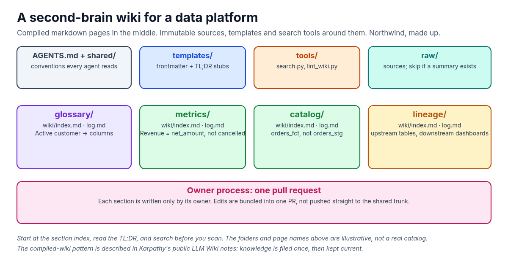
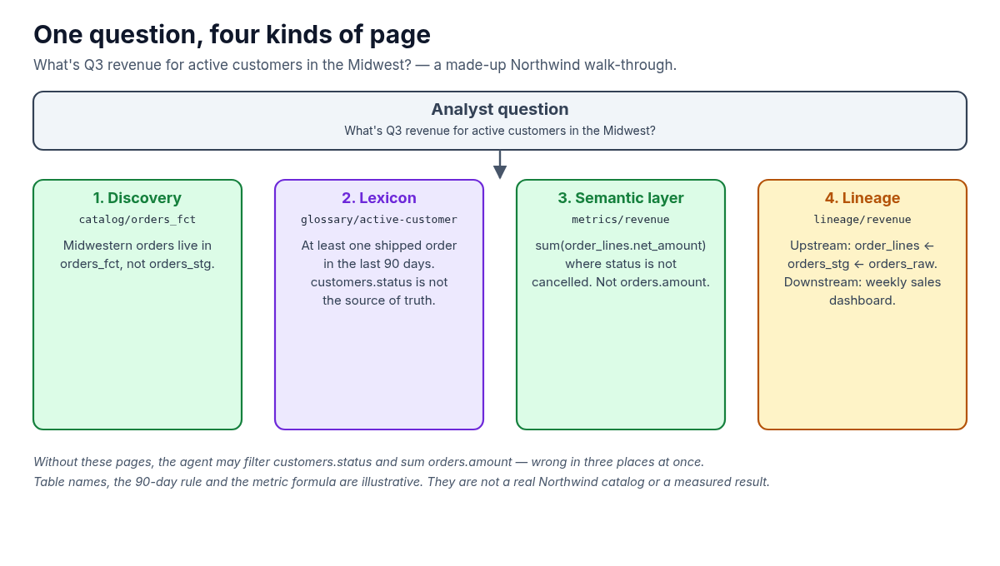
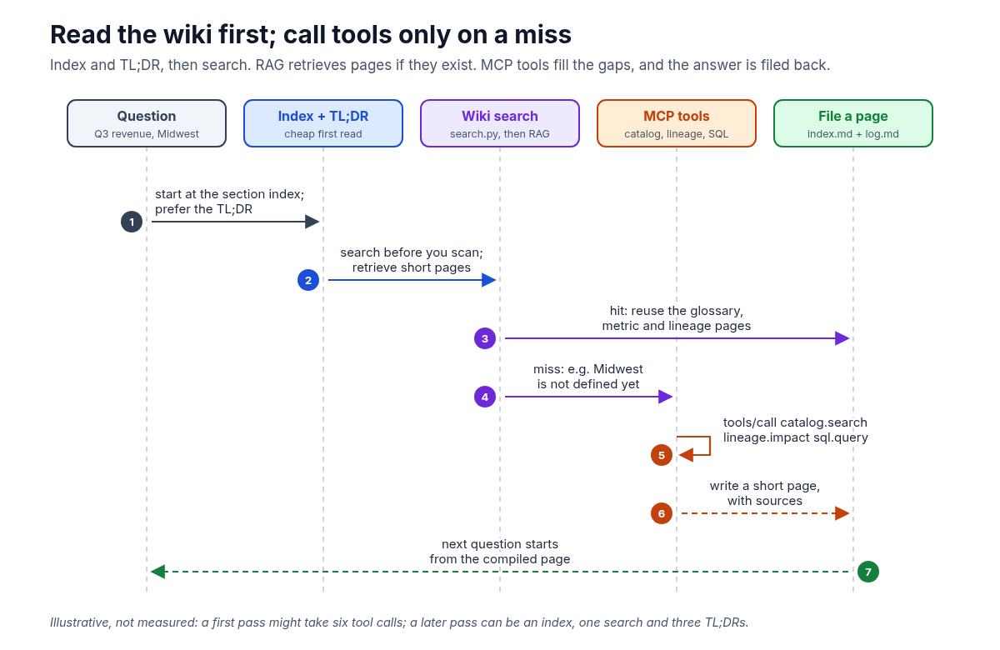

**Ask a data agent at Northwind what "active customer" means, and it may query three tables and give you three answers. The business term didn't change. The agent just started from scratch.**

In the [AI Agent Stack overview](/writing/ai-agent-stack-mcp-rag-apis-tools-plugins-skills/), I compared the six building blocks people mix up: APIs, tools, RAG, MCP, plugins and skills. Those pieces get work done in one session. They don't, by themselves, remember the last one. This article is about a durable layer that sits next to that stack: a **second brain** — an Obsidian-style markdown wiki that agents read, search and write back to, so definitions and answers accumulate instead of being rediscovered.

The idea of a compiled markdown wiki for LLMs has been described publicly, notably in Andrej Karpathy's notes on LLM knowledge bases. The walk-through below is a made-up Northwind data platform, the same fictional company as the issue tracker in the series. The tables, terms and counts are illustrative. They are not a real catalog, and they are not a measured benchmark.



## 1. What a second brain is

A second brain, in this sense, is a folder of markdown pages that outlasts any one prompt. Karpathy's contrast is the useful one. Typical RAG retrieves chunks from raw documents at query time, and the model rediscovers the answer from scratch. A wiki is compiled: the model incrementally writes and maintains short, interlinked pages, and later questions start from that compiled memory, not from the warehouse all over again.

Each page has YAML frontmatter (title, type, sources, a date) and a short **TL;DR** at the top. Each section has an `index.md` — every page plus a one-line summary — and an append-only `log.md` of changes. Agents start at the index, read the TL;DR, and stop early when that's enough.

A typical layout, made up for Northwind, looks like this:

```
.
├── AGENTS.md          # how agents must use the wiki
├── templates/         # page templates
├── tools/             # search.py, lint_wiki.py
├── shared/            # platform-wide conventions
├── glossary/          # business terms → columns
├── metrics/           # semantic-layer definitions
├── catalog/           # tables and datasets
└── lineage/           # upstream and downstream
```

Each domain folder keeps immutable sources in `raw/` and compiled pages in `wiki/`. Don't load `raw/` when a summary page already exists. Ownership is simple: a glossary page is edited by whoever owns glossary work; a metrics page by whoever owns the semantic layer. An owner process bundles the day's wiki edits into one pull request, rather than letting every agent push straight to the shared trunk.

## 2. Read cheap, then call tools

The token-saving rules are the point of the wiki, not an afterthought.

1. Start at the section `index.md`. Prefer the TL;DR.
2. Search before you scan: a small tool such as `search.py "active customer"` returns ranked paths with their TL;DRs.
3. Never open `raw/` if a wiki summary exists.
4. If the wiki does not have the answer, then call tools, and file a short page back so the next agent doesn't repeat the work.

This is the same instinct as [RAG](/writing/ai-agent-stack-03-rag-setup/): retrieve a small, relevant slice instead of stuffing a warehouse into the prompt. The wiki is the curated corpus. Retrieval can be a keyword search over pages, or an embedding index over the same markdown. The important part is that the corpus is compiled, short and owned.

## 3. One question, four kinds of page

Northwind's analyst asks:

> What's Q3 revenue for active customers in the Midwest?

Without a second brain, a typical agent might search the catalog for anything named "customer" or "revenue," run a few exploratory SQL queries, guess that `customers.status = 'active'` is the filter, and sum `orders.amount`. That can be wrong in three places at once: the table, the term and the metric.

With a second brain, the agent walks four kinds of page, in order.

**Data discovery.** The catalog page for `orders_fct` — a made-up fact table — says Midwestern orders live there, not in the raw `orders_stg` extract. The section index would have pointed at that page in one line.

**Data lexicon.** The glossary page **Active customer** says: a customer with at least one shipped order in the last 90 days. It also says `customers.status` is *not* the source of truth for this term — a note you'd lose if you only looked at column names.

**Semantic layer.** The metrics page **Revenue** says: `sum(order_lines.net_amount)` where `order_lines.status` is not `cancelled`. Not `orders.amount`. Not gross. The definition is the contract; SQL is just how you compute it.

**Data lineage.** The lineage page for Revenue lists upstream tables (`order_lines` ← `orders_stg` ← `orders_raw`) and a downstream weekly sales dashboard. If someone is about to change the grain of `net_amount`, the impact is visible before the query runs.



## 4. RAG over the wiki, tools when you must

When the pages exist, the agent doesn't need to browse the warehouse. [Module 03](/writing/ai-agent-stack-03-rag-setup/) showed RAG as retrieval over a corpus so the model can answer from the right context. Here the corpus is the wiki: retrieve the glossary, metric and lineage pages, then write the SQL with those definitions in context.

When a page does not exist — say, nobody has defined "Midwest" yet — the agent uses tools. In [Module 02](/writing/ai-agent-stack-02-tools-setup/), the model proposes a procedure and your code decides whether to run it. At Northwind those tools might be `catalog.search`, `lineage.impact` and `sql.query`, exposed through [MCP](/writing/ai-agent-stack-04-mcp-setup/) so any compatible host can call them. As I wrote in [RPC: The Call Style Under MCP and Agent Tools](/writing/rpc-the-call-style-under-mcp-and-tools/), those MCP calls are JSON-RPC under the hood: a method name, params and an id, not a guessed URL.

```json
{
  "jsonrpc": "2.0",
  "id": 1,
  "method": "tools/call",
  "params": {
    "name": "catalog.search",
    "arguments": {"q": "midwest region"}
  }
}
```

The last step is the one people skip: after the tool returns, the agent writes a short glossary page — "Midwest: the region codes IL, IN, IA, MI, MN, OH and WI in `dim_region`" — with a TL;DR, a source, and a line in `index.md` and `log.md`. That region list is illustrative, like the rest of the example. The next question doesn't pay for that discovery again.



## 5. Why this raises efficiency and cuts cost

I won't invent a real bill or a benchmark. The savings are structural, and a small illustrative walk-through makes them concrete.

- **File once, reuse.** The first time someone pins down "active customer," it becomes a page. Later agents read the TL;DR instead of re-querying `customers` and `orders`.
- **Fewer tool calls and tokens.** Illustrative, not a measured result: the first pass at the Q3 question might take six MCP calls (two catalog searches, a lineage lookup, three SQL probes) and a long dump of schemas into the prompt. The second pass, with the pages in place, can be an index read, one search hit and three short TL;DRs — no catalog crawl, no exploratory SQL.
- **Index and TL;DR first; search before you scan.** You don't load a long lineage export when the summary is two lines.
- **Consistent definitions.** The weekly report agent and the ad-hoc Q&A agent both read **Revenue** from the same page. They can't silently drift to `orders.amount` versus `order_lines.net_amount`.

The wiki doesn't replace the catalog, the lineage service or the warehouse. Those remain the systems of record. The second brain is the memory of *what we already decided they mean*.

## 6. A short checklist

When you stand up a second brain next to an agent stack:

1. Give every page frontmatter, a TL;DR and a home in a section index.
2. Teach agents to read the index and search before they call tools or open `raw/`.
3. Cover the four data-platform pages: catalog (discovery), glossary (lexicon), metrics (semantic layer) and lineage (impact).
4. Expose catalog, lineage and SQL as MCP tools for the gaps.
5. File every useful answer back as a page, in a pull request, not only in the chat.

The stack in the series — APIs, tools, RAG, MCP — is how an agent acts in one sitting. A second brain is how it stays consistent in the next one.

If you already have a catalog and a semantic layer, what would you put in the wiki first: the messy business terms, or the metrics everyone thinks they already agree on? I'd love to hear in the comments.

#AI #AIAgents #Data #RAG #MCP
