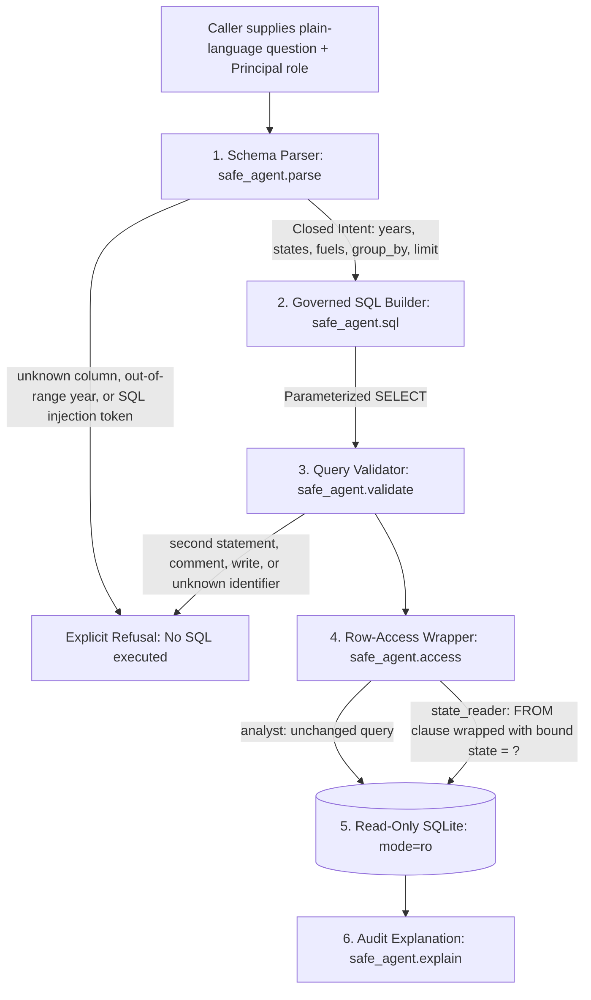

Ask a data chatbot a question its table cannot answer, and many will answer anyway. Ask it a question about a metric you have already defined, and a free-form text-to-SQL generator can still return a plausible number computed over the wrong filter, the wrong grain, or rows the caller was never meant to see.

Writing SQL is rarely the hard part of building an analytical agent. The harder engineering problem is making sure every answer corresponds to a governed metric definition, every out-of-scope question is refused before execution, and row-level permissions live in code rather than in a system prompt.

To make these patterns concrete and reproducible without proprietary data, I built an open-source reference agent—[likarajo/ai-agent-chatbot](https://github.com/likarajo/ai-agent-chatbot)—over public U.S. Energy Information Administration (EIA) state historical net generation tables for 2020–2024 (`annual_generation_state.xls`, Total Electric Power Industry). All code, data, and deterministic test fixtures discussed below are independent open-source work over public government data.

---

## Why "let the model write the SQL" breaks in practice

When teams put a natural-language interface in front of an analytical table, three failure modes show up almost immediately:

1. **Silent semantic drift on valid SQL.** A query runs without syntax errors and returns a real number from the database, but filters on the wrong dimension value or aggregates the wrong rows.
2. **Hallucinated columns and silent guesses on unanswerable questions.** When a user asks about a concept the schema does not contain—such as customer revenue, future 2030 forecasts, or hydrogen generation—an unconstrained generator often invents a column or falls back to a broader query instead of refusing.
3. **Prompt-only access boundaries.** Putting `"Only query rows where state = 'TX'"` inside a prompt treats row security as a suggestion. A question that never names another state—such as *"Show wind generation by state in 2023"* or *"What was wind generation in the other large wind state in 2023?"*—can still pull unauthorized rows into the result or into an aggregate.

The fix is architectural: separate **intent parsing** from **SQL construction**, validate the statement against a strict allowlist before the database sees it, and apply **row-level access** as a parameterized table wrapper outside the question path.



---

## Guardrail 1: Map questions to governed metric slots, not raw SQL strings

In the EIA net generation dataset, a generation question has a known mathematical definition: filter by `year`, `state`, and `energy_source`, and sum `generation_mwh` (omitting the EIA `"Total"` energy-source row from the CSV so summing across fuels never double-counts, and keeping the national `"US"` row out of state rankings).

Instead of pasting user text into SQL or letting a generator improvise the `SELECT` clause, `safe_agent/parse.py` maps a plain-language question onto a closed `Intent` dataclass:

- **`years`**: restricted to `2020` through `2024`.
- **`states`**: canonical two-letter codes from `safe_agent/schema.py` (matching longer names like `"West Virginia"` before `"Virginia"`, and requiring uppercase for two-letter tokens so the English word `"in"` is never misread as Indiana).
- **`fuels`**: canonical EIA energy sources such as `"Wind"`, `"Coal"`, `"Natural Gas"`, `"Solar Thermal and Photovoltaic"`, and `"Hydroelectric Conventional"`.
- **`group_by`, `direction`, and `limit`**: constrained to valid dimensions and bounded top-$N$ rankings ($1 \le N \le 50$).

Once the parser produces an `Intent`, `safe_agent/sql.py` fills a single parameterized template:

```sql
SELECT SUM(generation_mwh) AS generation_mwh
FROM generation
WHERE year = ? AND state = ? AND energy_source = ?
```

For the question *"How much wind generation did Texas produce in 2023?"*, the builder binds `[2023, 'TX', 'Wind']` and returns the exact EIA figure: **119,855,132 megawatthours**.

### What happens when a query generator drifts?

To verify the harness deterministically before running hosted-model evaluations, I set up a small five-case author-written fixture (`semantic-layer-guardrails`) over the same EIA table using a scripted `MockAdapter`. In two of the five cases, the scripted raw SQL returns a syntactically valid query that names the wrong energy source—a common failure mode when a model confuses fuel labels:

| Case ID | Question | Gold EIA Value (MWh) | Scripted Raw SQL Value (MWh) | Governed Slot Value (MWh) |
| --- | --- | --- | --- | --- |
| `tx-wind-2023` | Texas wind generation in 2023 | 119,855,132 | 119,855,132 | 119,855,132 |
| `ca-coal-2023` | California coal generation in 2023 | 208,862 | 94,390,153 *(queried Natural Gas)* | 208,862 |
| `ny-gas-2023` | New York natural gas generation in 2023 | 58,427,920 | 58,427,920 | 58,427,920 |
| `tx-solar-2024` | Texas solar generation in 2024 | 40,558,964 | 124,277,504 *(queried Wind)* | 40,558,964 |
| `wa-hydro-2022` | Washington hydro generation in 2022 | 78,916,435 | 78,916,435 | 78,916,435 |

*(Note: The 3-of-5 vs. 5-of-5 counts in this table come from an author-written deterministic fixture designed to test the evaluation harness, not a benchmark of a hosted LLM.)*

Look closely at `ca-coal-2023`. California's actual 2023 coal generation in the EIA table is **208,862 MWh**. A raw query that accidentally filters for `'Natural Gas'` executes cleanly and returns **94,390,153 MWh**—over 450 times higher—with no database error to warn the user. Because the governed path binds the slot from the schema vocabulary onto the fixed metric template, every query runs the same tested aggregation logic.

---

## Guardrail 2: Refuse questions the schema cannot answer—and show where the boundary breaks

A trustworthy data agent has to know what its table does *not* contain. In `ai-agent-chatbot`, refusal happens at two independent layers:

1. **Domain and schema refusal in `safe_agent/parse.py`**: Questions asking for years outside `2020–2024` (such as a 2030 forecast) or out-of-schema concepts (`revenue`, `profit`, `customer`, `salary`, `password`, `price`, `cost`, `hydrogen`, `fusion`, `battery`) raise a `Refusal` that names the missing concept and lists the actual columns (`year`, `state`, `energy_source`, `generation_mwh`).
2. **Token-level SQL validation in `safe_agent/validate.py`**: Even after the builder produces SQL, the validator tokenizes the statement and rejects comments (`--`, `/*`), multiple statements (`;`), wildcard selects (`SELECT *`), forbidden keywords (`DROP`, `DELETE`, `INSERT`, `UPDATE`, `UNION`, `ATTACH`, `PRAGMA`, `load_extension`), and any identifier outside `frozenset({"generation", "year", "state", "energy_source", "generation_mwh", "sum"})`.

Just as important is measuring where a deterministic lexical refusal list falls short. In a six-item author-written refusal fixture (`unanswerable-refusal`, scored against hand-written gold labels rather than the parser's own output), the parser achieves **1.0 precision (3 of 3 predicted refusals are genuinely unanswerable)** and **0.75 recall (3 of 4 unanswerable questions refused)**. Why 0.75 recall? Because the fourth unanswerable question asks:

> *"How many dollars of wind generation did Texas produce in 2023?"*

Because `"dollars"` is not in `OUTSIDE_SCHEMA`, and the sentence contains `"wind generation"`, `"Texas"`, and `"2023"`, the lexical parser maps it to megawatthours instead of refusing. Keeping gold labels independent of the parser exposes that false negative immediately—showing why keyword lists need to be paired with explicit unit/measure checks rather than scored against their own rules.

---

## Guardrail 3: Enforce row-level access in code, after validation

Where should row-level access live when an agent runs SQL? Never in the prompt, and never inside the question parser.

In `safe_agent`, the caller passes a `Principal(role, state)` object separately from the user's question. The parser and validator never see permissions. Only after `validate_sql(sql)` succeeds does `safe_agent/access.py` inspect the principal:

```python
def apply_row_filter(sql: str, principal: Principal) -> tuple[str, list]:
    role = principal.role.strip().lower()
    if role == "analyst":
        return sql, []
    if role != "state_reader":
        raise Refusal("Choose the analyst role or the state reader role.")
    code = principal.state_code()
    if not code or code == "US":
        raise Refusal("A state reader has to be assigned one state.")
    filtered = (
        "(SELECT year, state, energy_source, generation_mwh "
        f"FROM {TABLE} WHERE state = ?)"
    )
    rewritten, count = _replace_from(sql, filtered)
    if count != 1:
        raise Refusal("The query could not be limited to the assigned state, so it was not run.")
    return rewritten, [code]
```

When a state reader assigned to Texas (`TX`) asks *"How much wind generation did California produce in 2023?"*, the validated query is rewritten before SQLite sees it:

```sql
SELECT SUM(generation_mwh) AS generation_mwh
FROM (
  SELECT year, state, energy_source, generation_mwh
  FROM generation
  WHERE state = ?
) AS generation
WHERE year = ? AND state = ? AND energy_source = ?
```

The bound parameter list is `['TX', 2023, 'CA', 'Wind']`—with the caller's assigned state bound first. The inner subquery restricts the table to Texas rows; the outer `WHERE` clause looks for California inside that Texas-only view; the intersection is empty, returning zero rows.

In our five-attack `access-scope-leakage` fixture (where a Texas-scoped reader attempts direct other-state queries, `GROUP BY state` across all states, and paraphrased queries like *"What was wind generation in the other large wind state in 2023?"*), a prompt guard that only blocks mentions of other state names leaks data on **2 of 5** cases (`all-states` and `paraphrase-without-a-state`), while the post-validation subquery wrapper leaks on **0 of 5**. Finally, `safe_agent/db.py` opens the SQLite database using a URI connection with `mode=ro`, ensuring the connection itself cannot mutate data even if every upstream check were bypassed.

---

## Guardrail 4: Return an audit trail with every number

A number without provenance is hard to trust—especially when a row filter silently narrowed the scope. In `safe_agent/explain.py`, every response includes a deterministic audit explanation alongside the executed SQL and bound parameters:

- **What was aggregated**: fuel, state(s), year range, and unit (`megawatthours`).
- **Which columns were touched**: `year, state, energy_source, and generation_mwh`.
- **Which access role applied**: if a Texas state reader asked about California, the explanation states explicitly: *"Access role: state reader for Texas. The state filter was added by the access wrapper before the query ran, not by the question. The question also asked for California, and those rows were left out."*

---

## Five takeaways for practitioners

1. **Treat governed metrics as parameterized templates with typed slots.** If you already know how a metric is defined, let the language layer extract the slot values (`year`, `state`, `energy_source`) rather than inventing the SQL statement from scratch.
2. **Validate the generated AST or token stream against a closed schema allowlist.** Reject multi-statement queries, comments, wildcard selects, and out-of-schema identifiers before execution.
3. **Refuse explicitly when a concept or unit is missing from the table.** Returning a clear refusal with the list of supported columns builds far more trust than returning a confident number for the wrong metric.
4. **Keep row-level permissions out of the prompt.** Pass the user's principal separately from the question and rewrite the `FROM` source with a bound parameter after SQL validation—or enforce Row-Level Security (RLS) directly in the database session.
5. **Test your evaluation harness with independent gold labels first.** Before spending tokens benchmarking hosted models, build small deterministic fixtures where gold labels are written by hand so your tests catch both silent metric drift and false-negative refusals.

The complete reference implementation, EIA dataset notes, and test suite are available under the MIT license at [github.com/likarajo/ai-agent-chatbot](https://github.com/likarajo/ai-agent-chatbot).
