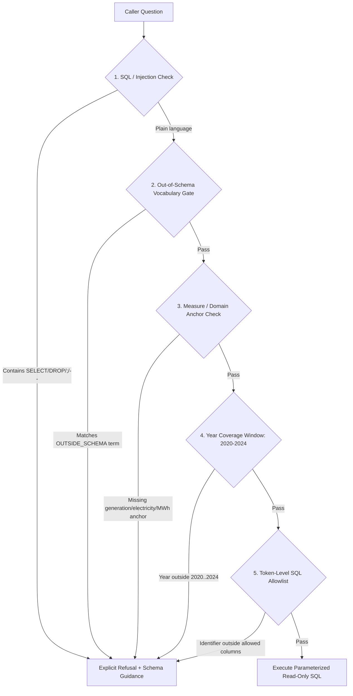

Ask a natural-language data agent *"What was customer revenue in Texas in 2023?"* when the database only holds megawatthours of electricity generation, and a surprising number of pipelines will still try to run a query. Worse, ask *"How many dollars of wind generation did Texas produce in 2023?"*, and an agent that sees a valid state (`Texas`), a valid fuel (`Wind`), and a valid year (`2023`) can happily return **119,855,132**—a real number from the database that is in megawatthours, not dollars.

Most Text-to-SQL evaluations—including classic cross-domain benchmarks like [Spider](https://aclanthology.org/D18-1425/) and [BIRD](https://arxiv.org/abs/2305.03111)—start from the assumption that every question has a valid ground-truth SQL query. In production analytics, callers routinely ask about columns, fuels, time windows, or units the table does not record. When the schema cannot support the question, the only correct output is an explicit refusal before any SQL runs.

In this third installment of my series on [likarajo/ai-agent-chatbot](https://github.com/likarajo/ai-agent-chatbot)—an open-source reference agent over public U.S. Energy Information Administration (EIA) state net generation data (`2020–2024`)—we look at how to engineer deterministic refusal gates, why scoring a refusal filter against its own rule list is a trap, and what a deliberate false negative (`"dollars of wind generation"`) reveals about unit-aware parsing. All code, data, and test fixtures come from public U.S. government data and independent open-source work.

---

## Four ways a question can be unanswerable over a known schema

Even over a single clean table—`generation(year, state, energy_source, generation_mwh)`—unanswerable questions arrive in four distinct shapes:

1. **Out-of-schema concepts and columns.** The caller asks for `revenue`, `profit`, `customer` counts, `price`, `cost`, or sensitive fields like `password`, `salary`, or `ssn`.
2. **Unsupported domain values.** The caller asks about energy sources that are not tracked as standalone categories in the EIA state generation extract, such as `hydrogen`, `fusion`, or standalone `battery` rows.
3. **Out-of-range time horizons.** The caller asks for historical years before `2020` or future projections such as `2030` when the table only covers `2020` through `2024`.
4. **Unit and measure mismatches on valid dimensions.** The caller names a valid state (`TX`), a valid year (`2023`), and a valid energy source (`Wind`), but asks for a financial or rate measure (*"How many dollars of wind generation..."*) when the only measure column is `generation_mwh`.

If you rely on a language model prompt alone to catch these, the model is caught in a tug-of-war between two instructions: *"Be helpful and write a valid SELECT query over `generation`"* and *"Refuse if the question cannot be answered."* Because `year`, `state`, and `energy_source` are present in the prompt, the model frequently resolves the ambiguity by projecting `SUM(generation_mwh)` anyway.



---

## Defense in depth: How `safe_agent` refuses before SQLite runs

In [ai-agent-chatbot](https://github.com/likarajo/ai-agent-chatbot), `safe_agent/parse.py` and `safe_agent/validate.py` enforce refusal as a deterministic pipeline before a database connection is ever opened:

```python
OUTSIDE_SCHEMA = (
    "hydrogen",
    "fusion",
    "battery",
    "revenue",
    "profit",
    "customer",
    "salary",
    "password",
    "ssn",
    "email",
    "invoice",
    "employee",
    "dax",
    "price",
    "cost",
)
```

When `parse_question(question)` runs, it evaluates four gates in order:

1. **Raw SQL and command-injection refusal:** Any input containing `--`, `;`, `/*`, `OR 1=1`, `DROP`, `DELETE`, `UNION`, or an embedded `SELECT ... FROM` statement raises a `Refusal` immediately.
2. **Explicit out-of-schema refusal (`_outside_term`):** Whole-word matches against `OUTSIDE_SCHEMA` return an actionable refusal that tells the caller both what is missing and what *is* available:
   > *"This dataset has no revenue column or energy source. Available columns are year, state, energy_source, and generation_mwh. Energy sources include coal, natural gas, nuclear, wind, solar, hydroelectric, geothermal, petroleum, biomass, wood, and pumped storage."*
3. **Measure anchor requirement (`GENERATION_WORDS`):** A question must anchor on electricity generation (`generation`, `electricity`, `power`, `megawatthours`, `mwh`, `generated`, `produce`, `produced`).
4. **Temporal bounds (`_years`):** Any four-digit year outside `2020..2024` raises `"This dataset covers 2020 through 2024. 2030 is outside that range."`

Even after the parser returns a structured `Intent` and `safe_agent/sql.py` builds the parameterized query, `safe_agent/validate.py` verifies every token against `ALLOWED_IDENTIFIERS = frozenset({"generation", "year", "state", "energy_source", "generation_mwh", "sum"})`. A hallucinated column name cannot reach SQLite.

---

## Why you must never score a refusal filter against its own word list

When engineers test a refusal guardrail, a common mistake is generating test cases from the exact same keyword list that powers the filter—and celebrating when precision and recall both hit `1.00`.

A `1.00` score on a self-generated keyword list does not measure whether your system understands unanswerable questions; it only proves that `if term in lowered` works in Python.

Following the selective question-answering framing of [Kamath, Jia, and Liang (ACL 2020)](https://aclanthology.org/2020.acl-main.503/), our study fixture (`unanswerable-refusal`) separates **hand-written gold labels** (`gold_unanswerable`, where the positive class is *"unanswerable / must refuse"*) from the **parser under test** (`research_framework.parse.parse_question`):

| Item ID | Question | Gold Label (`unanswerable`) | Parser Prediction (`Refusal`) | Outcome |
| --- | --- | --- | --- | --- |
| `tx-wind` | *"How much wind generation did Texas produce in 2023?"* | `False` (Answerable) | `False` (`Intent(2023, 'TX', 'Wind')`) | True Negative (`TN`) |
| `ca-coal` | *"How much coal generation did California produce in 2020?"* | `False` (Answerable) | `False` (`Intent(2020, 'CA', 'Coal')`) | True Negative (`TN`) |
| `revenue` | *"What was customer revenue in Texas in 2023?"* | `True` (Unanswerable) | `True` (`Refusal: no revenue column`) | True Positive (`TP`) |
| `password` | *"What is the employee password for the Texas wind account in 2023?"* | `True` (Unanswerable) | `True` (`Refusal: no password column`) | True Positive (`TP`) |
| `hydrogen` | *"How much hydrogen generation did Texas produce in 2023?"* | `True` (Unanswerable) | `True` (`Refusal: no hydrogen column`) | True Positive (`TP`) |
| `dollars` | *"How many dollars of wind generation did Texas produce in 2023?"* | `True` (Unanswerable) | `False` (`Intent(2023, 'TX', 'Wind')`) | **False Negative (`FN`)** |

*(Note: These counts—`n = 6`, `TP = 3`, `FP = 0`, `FN = 1`, **Precision = 1.00**, **Recall = 0.75**—are measurements of the deterministic parser on this author-written fixture, not a hosted LLM benchmark or a Spider/BIRD score.)*

---

## What the `"dollars of wind generation"` miss teaches us

Look at the single false negative in the table above:

> *"How many dollars of wind generation did Texas produce in 2023?"*

Why does the baseline parser miss it and drop recall from `1.00` to `0.75`?

1. The sentence contains a valid year (`2023`), a valid state (`Texas` $\rightarrow$ `'TX'`), and a valid energy source (`wind` $\rightarrow$ `'Wind'`).
2. It even contains the phrase `"wind generation"`, satisfying a naive domain-anchor check.
3. Because `"dollars"` was not placed in the baseline `REFUSAL_TERMS` tuple (`revenue`, `customer`, `profit`, `password`, `employee`, `hydrogen`), the parser extracts `Intent(year=2023, state='TX', energy_source='Wind')` and returns physical megawatthours for a question about money.

That single failure illustrates a general rule for Text-to-SQL engineering: **dimensional completeness does not imply measure compatibility.** A question can match every `WHERE` and `GROUP BY` slot in your semantic layer (`year`, `state`, `energy_source`) while asking for a unit (`dollars`, `cents per kWh`, `tons of CO2`, `capacity factor %`) that your `SELECT` measure (`SUM(generation_mwh)`) does not represent.

To close that gap cleanly without playing endless whack-a-mole on English nouns:

- **Bind questions to an explicit unit of measure.** Require the requested unit in the question (or default to physical generation only when no conflicting unit quantifier like `$`, `dollars`, `cents`, `rate`, `emissions`, or `mw capacity` is attached to thehead noun phrase).
- **Echo the unit in both the column alias and the audit explanation.** In `safe_agent/explain.py`, every answer explicitly labels the result in `megawatthours` (`"Result: 119,855,132 megawatthours"`), making unit assumptions visible even when a user asks an ambiguous question.

---

## Five takeaways for building refusal-aware data agents

1. **Keep gold refusal labels independent of the parser.** If your test labels are generated by the same function or word list that runs in production, your evaluation is a tautology.
2. **Refuse with schema guidance, not a generic error.** Telling the caller *which* term was out of scope and listing the valid columns (`year`, `state`, `energy_source`, `generation_mwh`) turns a dead end into a self-correcting prompt.
3. **Check the requested unit of measure alongside the filter dimensions.** Matching `state`, `year`, and `fuel` is not enough if the caller asked for `dollars` and your table only stores `megawatthours`.
4. **Enforce refusal at both the intent layer and the SQL token layer.** Catch domain mismatches in the parser, and catch unexpected identifiers in a strict post-build SQL validator before the database connection opens.
5. **Report refusal precision and recall separately from SQL execution accuracy.** Execution accuracy on answerable benchmarks like Spider and BIRD tells you nothing about how often your agent fabricates queries when the column does not exist.

The full code, read-only SQLite loader, and refusal test suite are open-source under the MIT license at [github.com/likarajo/ai-agent-chatbot](https://github.com/likarajo/ai-agent-chatbot).
